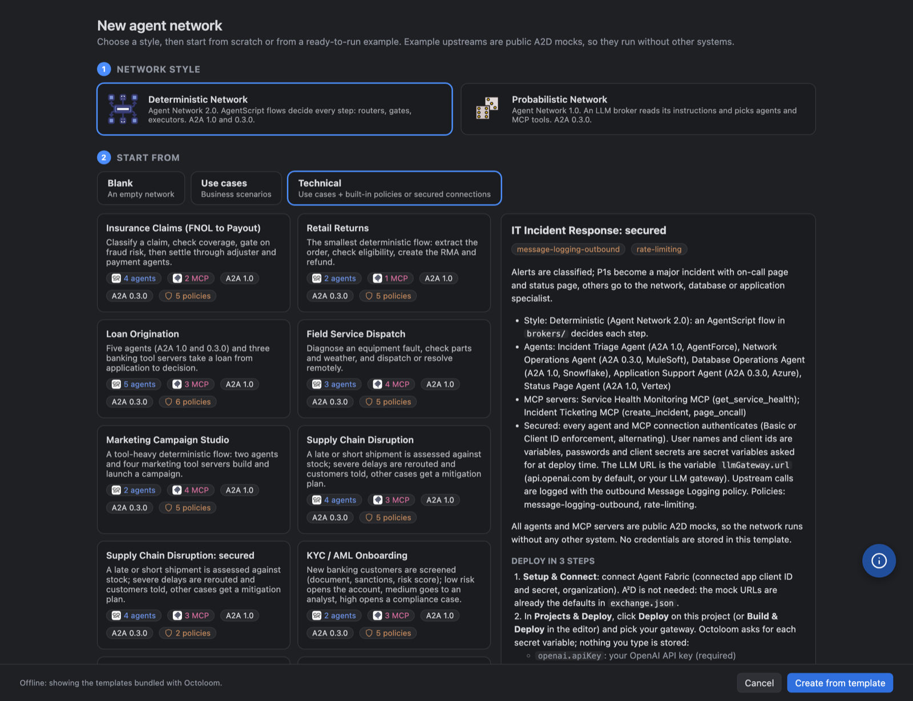
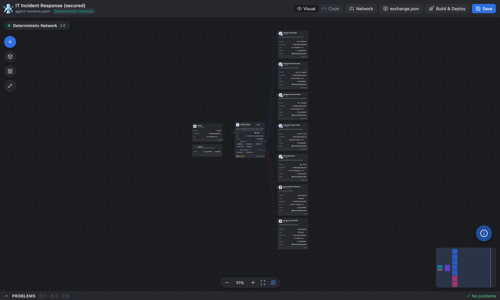
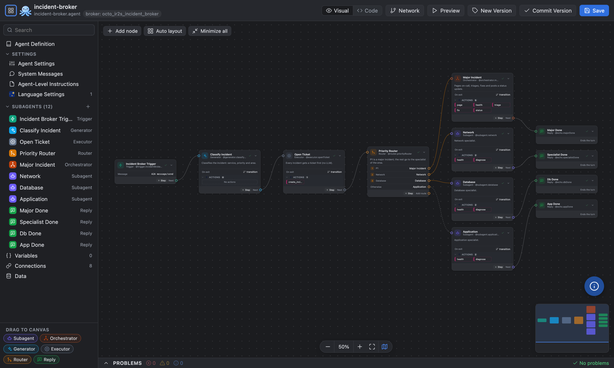
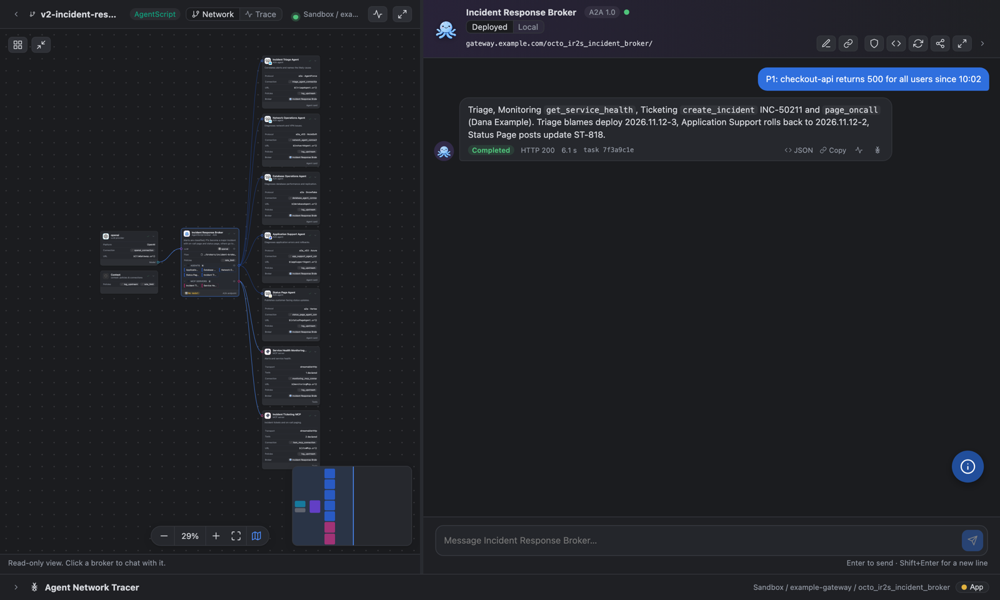

# Tutorial: IT Incident Response: secured

[All tutorials](../README.md) · [Getting started](../getting-started.md) · Deterministic network (Agent Network 2.0, AgentScript) · Technical · secured

> Alerts are classified; P1s become a major incident with on-call page and status page, others go to the network, database or application specialist. Secured: authenticated connections (Basic, Client ID enforcement) with secret variables, the LLM behind a gateway URL, outbound message logging.

| Agents | MCP servers | A2A | Policies | Template id |
|---|---|---|---|---|
| 5 | 2 | 1.0, 0.3.0 | 2 | `v2-incident-response-secured` |

There are two ways to use this template:

1. **[Just use it](#path-1-just-use-it)**: create the project, deploy it and chat with it in about 10 minutes.
2. **[Learn step by step](#path-2-learn-step-by-step)**: the same steps, with what each part of the network does and how Octoloom shows it.

## Before you start

- VS Code with **Octoloom for Agent Fabric** installed (Marketplace), version 0.9.25 or later.
- An Anypoint organization with Agent Fabric, a connected app (client ID and secret), an environment and a Flex gateway.
- An OpenAI API key (or an OpenAI-compatible LLM gateway).
- Nothing else: all agents and MCP servers are public A²D mocks, so the network runs without any other system.

## Path 1: Just use it

1. **Home → Start → New Deterministic Network.** In the dialog pick **Technical**, then the card **IT Incident Response: secured**. Choose a folder and click **Create**.
2. **Deploy.** In **Projects & Deploy**, click **Deploy** on this project (or **Build & Deploy** in the editor) and pick your gateway. Octoloom asks for each secret variable; nothing you type is stored:
   - `openai.apiKey`: OpenAI API key (secret, injected at deploy time)
   - `triageAgent.password`: Password (secret, entered at deploy time)
   - `networkAgent.clientSecret`: Client secret (secret, entered at deploy time)
   - `databaseAgent.password`: Password (secret, entered at deploy time)
   - `appSupportAgent.clientSecret`: Client secret (secret, entered at deploy time)
   - `statusPageAgent.password`: Password (secret, entered at deploy time)
   - `monitoringMcp.clientSecret`: Client secret (secret, entered at deploy time)
   - `itsmMcp.password`: Password (secret, entered at deploy time)
3. **Chat.** When the status light is green, click **Open chat** and paste:
   - `P1: checkout-api returns 500 for all users since 10:02`
   - `orders-db replication lag is 40 minutes`
   - `VPN in the Zurich office drops every few minutes`
   - `P1: checkout-api returns 500 for all users since 10:02`

Done. The rest of this page explains what you just ran.

## Path 2: Learn step by step

### Step 1. Connect Octoloom

Open **Setup & Connect** (Octoloom side bar) and connect **Agent Fabric**: the connected app client ID and secret and the organization. Pick the environment. A²D isn't needed: the mock URLs are already the defaults in `exchange.json`. The Tooling list shows Node.js, Java and anypoint-cli-v4 with its agent-network plugin. Use **Install** or **Repair** on any red row.

### Step 2. Create the project from the template

On **Home**, click **New Deterministic Network**. In **2 Start from**, choose **Technical** and click **IT Incident Response: secured**. The right side shows the template README: what it contains, **Deploy in 3 steps** and **Try it**. Keep the suggested name `incident-response-secured` or type your own, pick the folder and click **Create**.

Octoloom writes `agent-network.yaml`, `exchange.json`, `README.md` and the broker flow in `brokers/`, and opens the canvas. Every id gets the template prefix `octo_ir2s_`, so several templates can be deployed into one org side by side.

### Step 3. Read the network on the canvas

Each card is a part of `agent-network.yaml`. Click one to open it in the inspector on the right. Each change in the inspector is a change to the text, so the YAML stays the source of truth (**Code** view shows it).

- **Broker Incident Response Broker** (`octo_ir2s_incident_broker`): its AgentScript flow decides every step.
- **Agent Incident Triage Agent**: Correlates alerts and names the likely cause.
- **Agent Network Operations Agent**: Diagnoses network and VPN issues.
- **Agent Database Operations Agent**: Diagnoses database performance and replication.
- **Agent Application Support Agent**: Diagnoses application errors and rollbacks.
- **Agent Status Page Agent**: Publishes customer-facing status updates.
- **MCP server Service Health Monitoring MCP**: Alerts and service health. Tools: `get_service_health`.
- **MCP server Incident Ticketing MCP**: Incident tickets and on-call paging. Tools: `create_incident`, `page_oncall`.

Try this on the canvas: use the zoom bar and the minimap, drag a card, or **Auto layout**. The layout is saved per file. **Minimize all** turns the cards into icon tiles. Click a connection line to see which broker uses which agent or tool.

### Step 4. Follow the broker flow (AgentScript)

Double-click the broker card (or open `brokers/incident-broker.agent`). The flow editor shows the AgentScript program that decides every step. The LLM only extracts fields and writes text, so the same input always takes the same branch.

| Step | Kind | What it does |
|---|---|---|
| `incidentBrokerTrigger` | Trigger | Starts the flow when an A2A message arrives at the broker. |
| `classifyIncident` | Generator | Classifies the incident: service, priority and area. |
| `openTicket` | Executor | Every incident gets a ticket first (no LLM). |
| `priorityRouter` | Router | P1 is a major incident; the rest go to the specialist of the area. |
| `majorIncident` | Orchestrator | Pages on-call, triages, fixes and posts a status update. |
| `network` | Subagent | Network specialist. |
| `database` | Subagent | Database specialist. |
| `application` | Subagent | Application specialist. |
| `majorDone` | Echo | Ends the flow with the `majorDone` reply. |
| `specialistDone` | Echo | Ends the flow with the `specialistDone` reply. |
| `dbDone` | Echo | Ends the flow with the `dbDone` reply. |
| `appDone` | Echo | Ends the flow with the `appDone` reply. |

Click a step to edit it in the inspector. **+ Step** adds a node, and **+ Step → Patterns** inserts whole shapes such as retry, human in the loop or a guardrail check. **Code** shows the `.agent` text with completion.

### Step 5. See the secured connections

This variant adds Agent Fabric policies. Open a broker or connection and look at its **Policies** section. Each policy folds open to show its configuration:
- `message-logging-outbound`
- `rate-limiting`

Secured: every agent and MCP connection authenticates (Basic or Client ID enforcement, alternating). User names and client ids are variables, passwords and client secrets are secret variables asked for at deploy time. The LLM URL is the variable `llmGateway.url` (api.openai.com by default, or your LLM gateway). Upstream calls are logged with the outbound Message Logging policy. Policies: message-logging-outbound, rate-limiting.

Open a connection card. Its **Authentication** section shows the kind (Basic, Client ID enforcement and so on). Names and client IDs are normal variables; passwords and secrets are **secret variables** that Octoloom asks for at deploy time and never stores.

Run **Governance** (shield icon in the canvas toolbar) to check the project against the Agent Fabric rulesets. It runs locally, and findings show on the cards with **Fix** where one exists.

### Step 6. Validate and build

In the canvas toolbar, open the CLI menu: **Validate** does a dry run of build, publish and deploy and lists problems in the Problems panel (click one to jump to the card). **Build** repairs and packages the project locally with anypoint-cli-v4.

The variables of this template (in `exchange.json`, open it for the no-code form):

| Variable | What | Default |
|---|---|---|
| `llmGateway.url` | OpenAI-compatible LLM endpoint: api.openai.com or your LLM gateway in front of it | `https://api.openai.com/v1` |
| `triageAgent.url` | Incident Triage Agent (A2D mock, A2A 1.0) URL | `https://www.a2d-ai.com/api/platform/56c3a3a9-56e1-4cdc-b9cd-c8868fcc7008/a2a` |
| `triageAgent.username` | User name for Basic authentication | `octoloom-demo` |
| `networkAgent.url` | Network Operations Agent (A2D mock, A2A 0.3.0) URL | `https://www.a2d-ai.com/api/platform/4f5e984b-a170-47d7-a58e-23f6ed5cfa07/a2a` |
| `networkAgent.clientId` | Client ID for Client ID Enforcement | `octoloom-demo-client` |
| `databaseAgent.url` | Database Operations Agent (A2D mock, A2A 1.0) URL | `https://www.a2d-ai.com/api/platform/d26ed478-0c67-4c5b-8efd-636dcfd27db2/a2a` |
| `databaseAgent.username` | User name for Basic authentication | `octoloom-demo` |
| `appSupportAgent.url` | Application Support Agent (A2D mock, A2A 0.3.0) URL | `https://www.a2d-ai.com/api/platform/8272582f-f9b4-42e8-b5f3-cd27c8751e02/a2a` |
| `appSupportAgent.clientId` | Client ID for Client ID Enforcement | `octoloom-demo-client` |
| `statusPageAgent.url` | Status Page Agent (A2D mock, A2A 1.0) URL | `https://www.a2d-ai.com/api/platform/7ff8f6e8-6ee3-41e0-855c-efbdd7c7c5f2/a2a` |
| `statusPageAgent.username` | User name for Basic authentication | `octoloom-demo` |
| `monitoringMcp.url` | Service Health Monitoring MCP (A2D mock) base URL | `https://www.a2d-ai.com/api/platform/f76580a4-c9cf-4e67-a5f9-96a717075626/` |
| `monitoringMcp.clientId` | Client ID for Client ID Enforcement | `octoloom-demo-client` |
| `itsmMcp.url` | Incident Ticketing MCP (A2D mock) base URL | `https://www.a2d-ai.com/api/platform/3c7aac35-436f-4c5c-b436-7430d2d254d2/` |
| `itsmMcp.username` | User name for Basic authentication | `octoloom-demo` |

### Step 7. Deploy

Open **Projects & Deploy** and click **Deploy** on the project (or **Deploy…** on the canvas). Pick your gateway (the chips show its status and space), keep **Tracing**, **Wait until the network is ready** and **Publish before deploy** on, then enter the secrets. Nothing you type is stored:

- `openai.apiKey`: OpenAI API key (secret, injected at deploy time)
- `triageAgent.password`: Password (secret, entered at deploy time)
- `networkAgent.clientSecret`: Client secret (secret, entered at deploy time)
- `databaseAgent.password`: Password (secret, entered at deploy time)
- `appSupportAgent.clientSecret`: Client secret (secret, entered at deploy time)
- `statusPageAgent.password`: Password (secret, entered at deploy time)
- `monitoringMcp.clientSecret`: Client secret (secret, entered at deploy time)
- `itsmMcp.password`: Password (secret, entered at deploy time)

The square status light goes from blue (deploying) to green (**Deployed and running**). The deployment box lists every broker URL; click one to copy it.

### Step 8. Chat with the broker

Click **Open chat** on the deployment box. On the left is the network (the cards light up as they are called), and on the right is the conversation with its task states. Paste the prompts one at a time:

*The reply in the screenshot is an illustration: it shows what the broker answers. The real wording changes from run to run.*

| Prompt | You should see |
|---|---|
| `P1: checkout-api returns 500 for all users since 10:02` | Triage, Monitoring `get_service_health`, Ticketing `create_incident` INC-50211 and `page_oncall` (Dana Example). Triage blames deploy 2026.11.12-3, Application Support rolls back to 2026.11.12-2, Status Page posts update ST-818. |
| `orders-db replication lag is 40 minutes` | Routed to the Database Operations Agent: batch job BJ-4410 is throttled, lag below 1 minute in 15 minutes. |
| `VPN in the Zurich office drops every few minutes` | Routed to the Network Operations Agent: vpn-zrh-2 flaps because of an expiring certificate; failover to vpn-zrh-1, renewal at 14:00. |
| `P1: checkout-api returns 500 for all users since 10:02` | Same answer as the plain variant: the A²D mocks accept any credentials. The Tracer shows each authenticated upstream call, and the outbound Message Logging policy writes one log line per call. |

The broker is deterministic: the branches are fixed in the flow in `brokers/` (open the `.agent` file to see them). The LLM only reads the ids from your prompt and writes the reply text, so the same input takes the same branch.

### Step 9. Trace a reply

Under each reply, the **Tracer** icon opens the task in the **Agent Network Tracer**: a waterfall of every call the broker made (gateway, broker, LLM, A2A agents, MCP tools) on one time axis, coloured like the cards. Errors are red. Click a span to see its request and response. The **Network** view shows the same reply as a sequence of calls.

### Step 10. Share it (optional)

The **Share** icon in the chat header opens the Share dialog. **A²D sessions** invites people by email to chat with this deployed broker and brings their passed / failed marks and comments back. **Local portal** generates a small web chat you can run or host anywhere.

## What you learned

- How a deterministic network is built: an AgentScript flow decides every step; the LLM extracts and writes text.
- How the canvas, the inspector and the code view edit the same YAML.
- How policies are attached and checked with Governance.
- How authenticated connections use variables and secret variables.
- How to validate, build, deploy, chat and trace with Octoloom.

## Next

- Previous: [Supply Chain Disruption: governed](../v2-supply-chain-governed/README.md)
- Next: [KYC / AML Onboarding: secured](../v2-kyc-onboarding-secured/README.md)
- Same use case, plain variant: [IT Incident Response](../v2-incident-response/README.md)
- Same use case, governed variant: [IT Incident Response: governed](../v2-incident-response-governed/README.md)
- [All tutorials](../README.md)

---
Generated from the `v2-incident-response-secured` template (Octoloom `media/templates/v2-incident-response-secured`). Screenshots use fake data.
