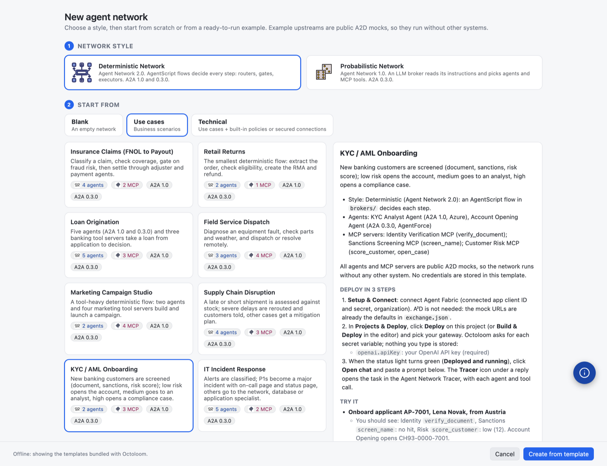
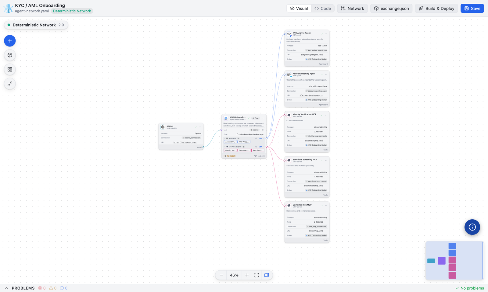
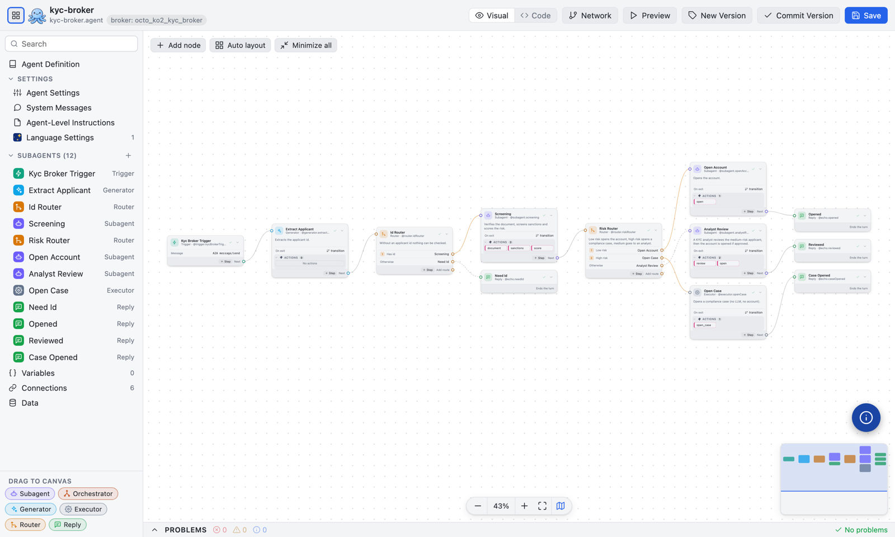
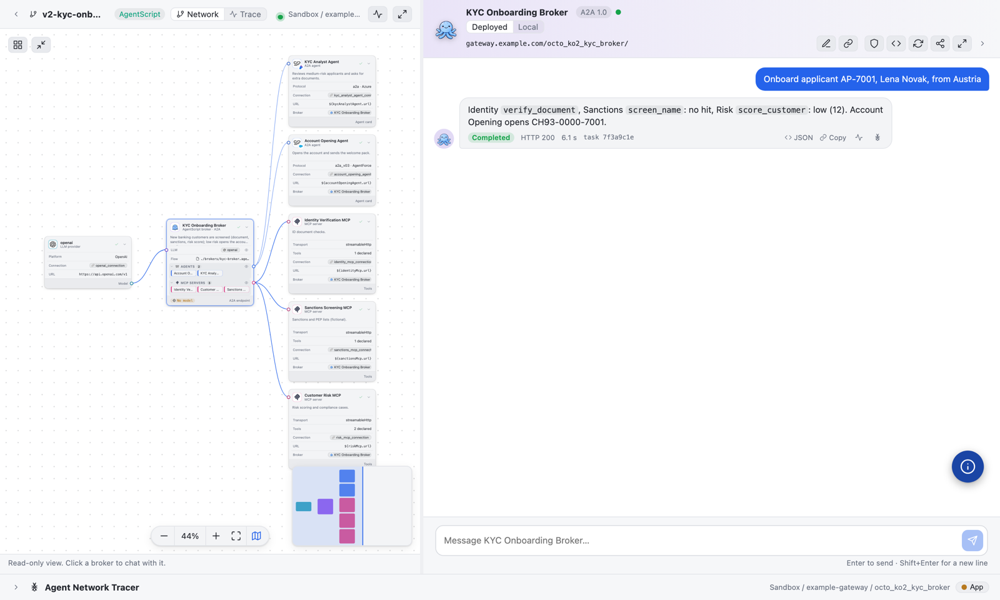

# Tutorial: KYC / AML Onboarding

[All tutorials](../README.md) · [Getting started](../getting-started.md) · Deterministic network (Agent Network 2.0, AgentScript) · Use case

> New banking customers are screened (document, sanctions, risk score); low risk opens the account, medium goes to an analyst, high opens a compliance case.

| Agents | MCP servers | A2A | Policies | Template id |
|---|---|---|---|---|
| 2 | 3 | 1.0, 0.3.0 | 0 | `v2-kyc-onboarding` |

There are two ways to use this template:

1. **[Just use it](#path-1-just-use-it)**: create the project, deploy it and chat with it in about 10 minutes.
2. **[Learn step by step](#path-2-learn-step-by-step)**: the same steps, with what each part of the network does and how Octoloom shows it.

## Before you start

- VS Code with **Octoloom for Agent Fabric** installed (Marketplace), version 0.9.25 or later.
- An Anypoint organization with Agent Fabric, a connected app (client ID and secret), an environment and a Flex gateway.
- An OpenAI API key (or an OpenAI-compatible LLM gateway).
- Nothing else: all agents and MCP servers are public A²D mocks, so the network runs without any other system.

## Path 1: Just use it

1. **Home → Start → New Deterministic Network.** In the dialog pick **Use cases**, then the card **KYC / AML Onboarding**. Choose a folder and click **Create**.
2. **Deploy.** In **Projects & Deploy**, click **Deploy** on this project (or **Build & Deploy** in the editor) and pick your gateway. Octoloom asks for each secret variable; nothing you type is stored:
   - `openai.apiKey`: OpenAI API key (secret, injected at deploy time)
3. **Chat.** When the status light is green, click **Open chat** and paste:
   - `Onboard applicant AP-7001, Lena Novak, from Austria`
   - `Onboard applicant AP-7002 from Germany`
   - `Onboard applicant AP-7003, Victor Example, from Panama`
   - `Onboard applicant AP-9999`

Done. The rest of this page explains what you just ran.

## Path 2: Learn step by step

### Step 1. Connect Octoloom

Open **Setup & Connect** (Octoloom side bar) and connect **Agent Fabric**: the connected app client ID and secret and the organization. Pick the environment. A²D isn't needed: the mock URLs are already the defaults in `exchange.json`. The Tooling list shows Node.js, Java and anypoint-cli-v4 with its agent-network plugin. Use **Install** or **Repair** on any red row.

### Step 2. Create the project from the template

On **Home**, click **New Deterministic Network**. In **2 Start from**, choose **Use cases** and click **KYC / AML Onboarding**. The right side shows the template README: what it contains, **Deploy in 3 steps** and **Try it**. Keep the suggested name `kyc-onboarding` or type your own, pick the folder and click **Create**.

Octoloom writes `agent-network.yaml`, `exchange.json`, `README.md` and the broker flow in `brokers/`, and opens the canvas. Every id gets the template prefix `octo_ko2_`, so several templates can be deployed into one org side by side.

### Step 3. Read the network on the canvas

Each card is a part of `agent-network.yaml`. Click one to open it in the inspector on the right. Each change in the inspector is a change to the text, so the YAML stays the source of truth (**Code** view shows it).

- **Broker KYC Onboarding Broker** (`octo_ko2_kyc_broker`): its AgentScript flow decides every step.
- **Agent KYC Analyst Agent**: Reviews medium-risk applicants and asks for extra documents.
- **Agent Account Opening Agent**: Opens the account and sends the welcome pack.
- **MCP server Identity Verification MCP**: ID document checks. Tools: `verify_document`.
- **MCP server Sanctions Screening MCP**: Sanctions and PEP lists (fictional). Tools: `screen_name`.
- **MCP server Customer Risk MCP**: Risk scoring and compliance cases. Tools: `score_customer`, `open_case`.

Try this on the canvas: use the zoom bar and the minimap, drag a card, or **Auto layout**. The layout is saved per file. **Minimize all** turns the cards into icon tiles. Click a connection line to see which broker uses which agent or tool.

### Step 4. Follow the broker flow (AgentScript)

Double-click the broker card (or open `brokers/kyc-broker.agent`). The flow editor shows the AgentScript program that decides every step. The LLM only extracts fields and writes text, so the same input always takes the same branch.

| Step | Kind | What it does |
|---|---|---|
| `kycBrokerTrigger` | Trigger | Starts the flow when an A2A message arrives at the broker. |
| `extractApplicant` | Generator | Extracts the applicant id. |
| `idRouter` | Router | Without an applicant id nothing can be checked. |
| `screening` | Subagent | Verifies the document, screens sanctions and scores the risk. |
| `riskRouter` | Router | Low risk opens the account, high risk opens a compliance case, medium goes to an analyst. |
| `openAccount` | Subagent | Opens the account. |
| `analystReview` | Subagent | A KYC analyst reviews the medium-risk applicant, then the account is opened if approved. |
| `openCase` | Executor | Opens a compliance case (no LLM, no account). |
| `needId` | Echo | Ends the flow with the `needId` reply. |
| `opened` | Echo | Ends the flow with the `opened` reply. |
| `reviewed` | Echo | Ends the flow with the `reviewed` reply. |
| `caseOpened` | Echo | Ends the flow with the `caseOpened` reply. |

Click a step to edit it in the inspector. **+ Step** adds a node, and **+ Step → Patterns** inserts whole shapes such as retry, human in the loop or a guardrail check. **Code** shows the `.agent` text with completion.

### Step 5. Validate and build

In the canvas toolbar, open the CLI menu: **Validate** does a dry run of build, publish and deploy and lists problems in the Problems panel (click one to jump to the card). **Build** repairs and packages the project locally with anypoint-cli-v4.

The variables of this template (in `exchange.json`, open it for the no-code form):

| Variable | What | Default |
|---|---|---|
| `kycAnalystAgent.url` | KYC Analyst Agent (A2D mock, A2A 1.0) URL | `https://www.a2d-ai.com/api/platform/9d2f67ee-62ae-4e7a-85aa-86cc134bd34c/a2a` |
| `accountOpeningAgent.url` | Account Opening Agent (A2D mock, A2A 0.3.0) URL | `https://www.a2d-ai.com/api/platform/7c76d68f-65b2-40ba-9139-77c6a4d796e0/a2a` |
| `identityMcp.url` | Identity Verification MCP (A2D mock) base URL | `https://www.a2d-ai.com/api/platform/bc1c60ca-df29-4d9d-b25c-2b839730f8d5/` |
| `sanctionsMcp.url` | Sanctions Screening MCP (A2D mock) base URL | `https://www.a2d-ai.com/api/platform/b1b3a5b7-5bbc-4764-8194-e6577ab4f52a/` |
| `riskMcp.url` | Customer Risk MCP (A2D mock) base URL | `https://www.a2d-ai.com/api/platform/08c986b9-6c22-4e6d-9323-67d551582ab5/` |

### Step 6. Deploy

Open **Projects & Deploy** and click **Deploy** on the project (or **Deploy…** on the canvas). Pick your gateway (the chips show its status and space), keep **Tracing**, **Wait until the network is ready** and **Publish before deploy** on, then enter the secrets. Nothing you type is stored:

- `openai.apiKey`: OpenAI API key (secret, injected at deploy time)

The square status light goes from blue (deploying) to green (**Deployed and running**). The deployment box lists every broker URL; click one to copy it.

### Step 7. Chat with the broker

Click **Open chat** on the deployment box. On the left is the network (the cards light up as they are called), and on the right is the conversation with its task states. Paste the prompts one at a time:

*The reply in the screenshot is an illustration: it shows what the broker answers. The real wording changes from run to run.*

| Prompt | You should see |
|---|---|
| `Onboard applicant AP-7001, Lena Novak, from Austria` | Identity `verify_document`, Sanctions `screen_name`: no hit, Risk `score_customer`: low (12). Account Opening opens CH93-0000-7001. |
| `Onboard applicant AP-7002 from Germany` | Risk medium (48): the KYC Analyst confirms the source of funds, and Account Opening opens CH93-0000-7002 with enhanced monitoring. |
| `Onboard applicant AP-7003, Victor Example, from Panama` | Sanctions hit (0.93), risk high (91): Risk `open_case` opens CMP-2026-0419. No account. |
| `Onboard applicant AP-9999` | No document on file, so the risk band is medium and the KYC Analyst asks for more proof; no account is opened. |

The broker is deterministic: the branches are fixed in the flow in `brokers/` (open the `.agent` file to see them). The LLM only reads the ids from your prompt and writes the reply text, so the same input takes the same branch.

### Step 8. Trace a reply

Under each reply, the **Tracer** icon opens the task in the **Agent Network Tracer**: a waterfall of every call the broker made (gateway, broker, LLM, A2A agents, MCP tools) on one time axis, coloured like the cards. Errors are red. Click a span to see its request and response. The **Network** view shows the same reply as a sequence of calls.

### Step 9. Share it (optional)

The **Share** icon in the chat header opens the Share dialog. **A²D sessions** invites people by email to chat with this deployed broker and brings their passed / failed marks and comments back. **Local portal** generates a small web chat you can run or host anywhere.

## What you learned

- How a deterministic network is built: an AgentScript flow decides every step; the LLM extracts and writes text.
- How the canvas, the inspector and the code view edit the same YAML.
- How to validate, build, deploy, chat and trace with Octoloom.

## Next

- Previous: [Insurance Claims (FNOL to Payout)](../v2-insurance-claims/README.md)
- Next: [Loan Origination](../v2-loan-origination/README.md)
- Same use case, governed variant: [KYC / AML Onboarding: governed](../v2-kyc-onboarding-governed/README.md)
- Same use case, secured variant: [KYC / AML Onboarding: secured](../v2-kyc-onboarding-secured/README.md)
- [All tutorials](../README.md)

---
Generated from the `v2-kyc-onboarding` template (Octoloom `media/templates/v2-kyc-onboarding`). Screenshots use fake data.
