# Tutorial: Loan Origination: governed

[All tutorials](../README.md) · [Getting started](../getting-started.md) · Deterministic network (Agent Network 2.0, AgentScript) · Technical · governed

> Five agents (A2A 1.0 and 0.3.0) and three banking tool servers take a loan from application to decision. Adds built-in policies: a2a-v1-pii-detector, header-injection, a-two-a-pii-detector, mcp-pii-detector, mcp-schema-validation, rate-limiting.

| Agents | MCP servers | A2A | Policies | Template id |
|---|---|---|---|---|
| 5 | 3 | 1.0, 0.3.0 | 6 | `v2-loan-origination-governed` |

There are three ways to use this template:

1. **[Just use it](#path-1-just-use-it)**: create the project, deploy it and chat with it in about 10 minutes.
2. **[Learn step by step](#path-2-learn-step-by-step)**: the same steps, with what each part of the network does and how Octoloom shows it.
3. **[Build it from scratch](#path-3-build-it-from-scratch)**: start from a blank project and build the same network yourself, no code, one screenshot per step.

## Before you start

- VS Code with **Octoloom for Agent Fabric** installed (Marketplace), version 0.9.25 or later.
- An Anypoint organization with Agent Fabric, an environment, a [Small Managed Omni Gateway](https://octoloom.a2d-ai.com/start/gateway/) and a [connected app](https://octoloom.a2d-ai.com/start/connected-app/) (client ID and secret). New to Anypoint? **[Before you start](https://octoloom.a2d-ai.com/start/)** shows the trial account, the gateway, the connected app and connecting Octoloom, step by step with videos.
- An OpenAI API key (or an OpenAI-compatible LLM gateway).
- Nothing else: all agents and MCP servers are public A²D mocks, so the network runs without any other system.

## Path 1: Just use it

1. **Home → Start → New Deterministic Network.** In the dialog pick **Technical**, then the card **Loan Origination** (the one with the policies chip). Choose a folder and click **Create**.
2. **Deploy.** In **Projects & Deploy**, click **Deploy** on this project (or **Build & Deploy** in the editor) and pick your gateway. Octoloom asks for each secret variable; nothing you type is stored:
   - `openai.apiKey`: OpenAI API key (secret, injected at deploy time)
3. **Chat.** When the status light is green, click **Open chat** and paste:
   - `Applicant APP-100 asks for a 25,000 CHF personal loan`
   - `Applicant APP-200 wants 300,000 CHF for a mortgage`
   - `My email is jane.doe@example.com and my phone is +41 79 123 45 67. Applicant APP-100 asks for a 25,000 CHF personal loan`
   - `Send the first prompt more than 30 times within a minute`

Done. The rest of this page explains what you just ran.

## Path 2: Learn step by step

### Step 1. Connect Octoloom

Open **Setup & Connect** (Octoloom side bar) and connect **Agent Fabric**: the connected app client ID and secret and the organization. Pick the environment. A²D isn't needed: the mock URLs are already the defaults in `exchange.json`. The Tooling list shows Node.js, Java and anypoint-cli-v4 with its agent-network plugin. Use **Install** or **Repair** on any red row.

### Step 2. Create the project from the template

On **Home**, click **New Deterministic Network**. In **2 Start from**, choose **Technical** and click **Loan Origination**. The right side shows the template README: what it contains, **Deploy in 3 steps** and **Try it**. Keep the suggested name `loan-origination-governed` or type your own, pick the folder and click **Create**.

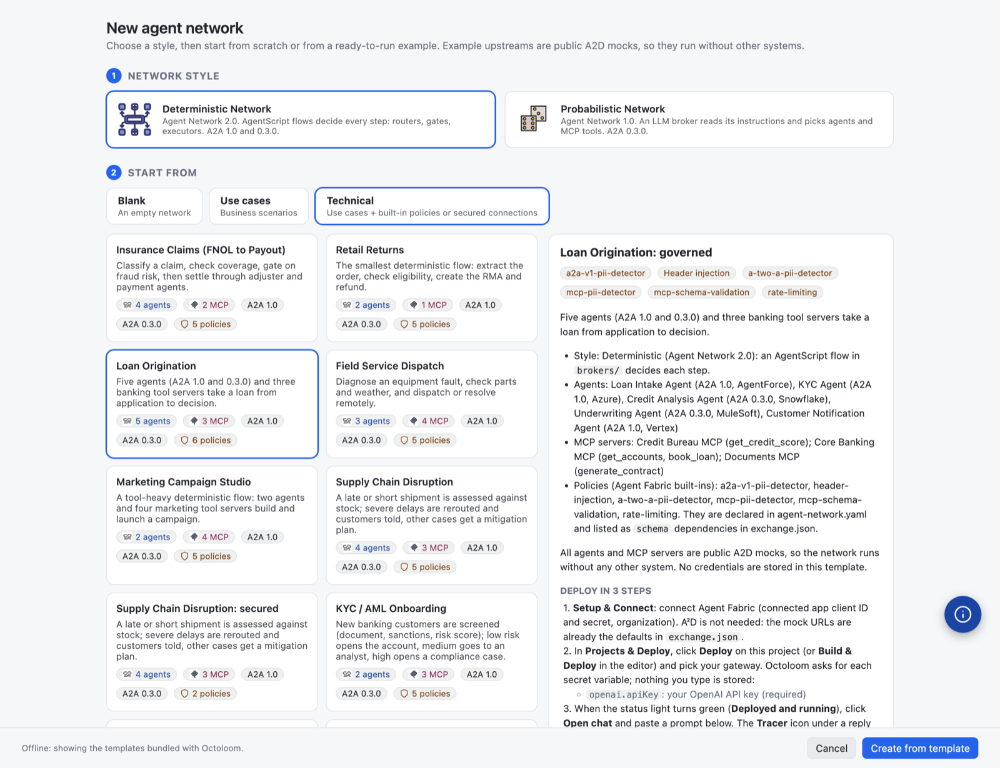

Octoloom writes `agent-network.yaml`, `exchange.json`, `README.md` and the broker flow in `brokers/`, and opens the canvas. Every id gets the template prefix `octo_lo2g_`, so several templates can be deployed into one org side by side.

### Step 3. Read the network on the canvas

Each card is a part of `agent-network.yaml`. Click one to open it in the inspector on the right. Each change in the inspector is a change to the text, so the YAML stays the source of truth (**Code** view shows it).

- **Broker Loan Origination Broker** (`octo_lo2g_loan_broker`): its AgentScript flow decides every step.
- **Agent Loan Intake Agent**: Collects application details and missing documents.
- **Agent KYC Agent**: Identity, sanctions and PEP screening.
- **Agent Credit Analysis Agent**: Analyses affordability from bureau and account data.
- **Agent Underwriting Agent**: Reviews applications that need a human-style underwriting decision.
- **Agent Customer Notification Agent**: Sends the decision to the applicant.
- **MCP server Credit Bureau MCP**: Credit bureau scores. Tools: `get_credit_score`.
- **MCP server Core Banking MCP**: Accounts and loan booking. Tools: `get_accounts`, `book_loan`.
- **MCP server Documents MCP**: Contract documents. Tools: `generate_contract`.

Try this on the canvas: use the zoom bar and the minimap, drag a card, or **Auto layout**. The layout is saved per file. **Minimize all** turns the cards into icon tiles. Click a connection line to see which broker uses which agent or tool.

### Step 4. Follow the broker flow (AgentScript)

Double-click the broker card (or open `brokers/loan-broker.agent`). The flow editor shows the AgentScript program that decides every step. The LLM only extracts fields and writes text, so the same input always takes the same branch.

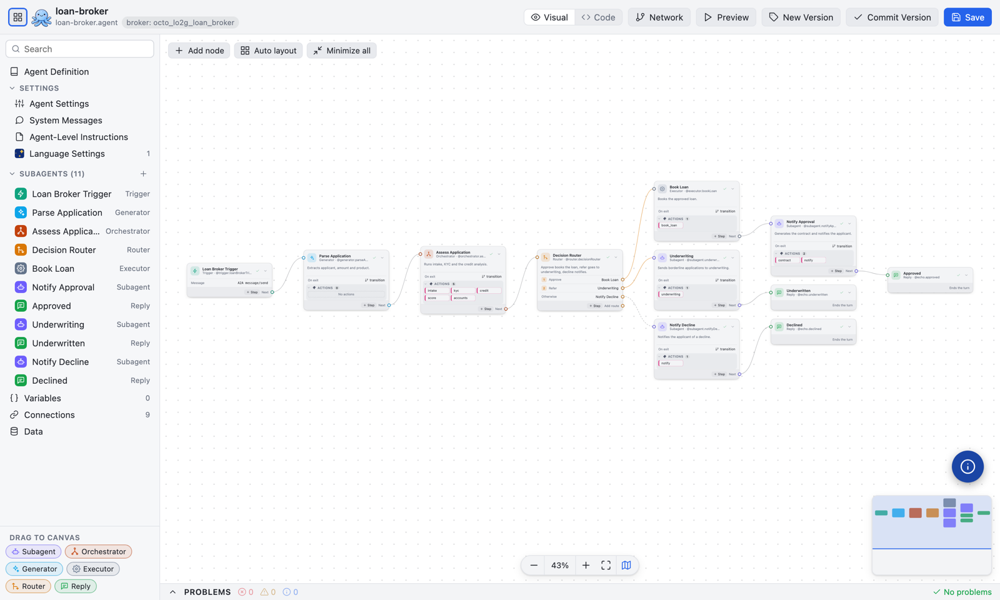

| Step | Kind | What it does |
|---|---|---|
| `loanBrokerTrigger` | Trigger | Starts the flow when an A2A message arrives at the broker. |
| `parseApplication` | Generator | Extracts applicant, amount and product. |
| `assess` | Orchestrator | Runs intake, KYC and the credit analysis. |
| `decisionRouter` | Router | Approve books the loan, refer goes to underwriting, decline notifies. |
| `bookLoan` | Executor | Books the approved loan. |
| `notifyApproval` | Subagent | Generates the contract and notifies the applicant. |
| `approved` | Echo | Ends the flow with the `approved` reply. |
| `underwrite` | Subagent | Sends borderline applications to underwriting. |
| `underwritten` | Echo | Ends the flow with the `underwritten` reply. |
| `notifyDecline` | Subagent | Notifies the applicant of a decline. |
| `declined` | Echo | Ends the flow with the `declined` reply. |
| `progressParseApplication` | Echo | Progress update (`TASK_STATE_WORKING`): tells the caller what comes next, then goes on to that step. With **Live** on, the chat shows it while the broker works. |
| `progressAssess` | Echo | Progress update (`TASK_STATE_WORKING`): tells the caller what comes next, then goes on to that step. With **Live** on, the chat shows it while the broker works. |
| `progressBookLoan` | Echo | Progress update (`TASK_STATE_WORKING`): tells the caller what comes next, then goes on to that step. With **Live** on, the chat shows it while the broker works. |
| `progressNotifyApproval` | Echo | Progress update (`TASK_STATE_WORKING`): tells the caller what comes next, then goes on to that step. With **Live** on, the chat shows it while the broker works. |
| `progressUnderwrite` | Echo | Progress update (`TASK_STATE_WORKING`): tells the caller what comes next, then goes on to that step. With **Live** on, the chat shows it while the broker works. |
| `progressNotifyDecline` | Echo | Progress update (`TASK_STATE_WORKING`): tells the caller what comes next, then goes on to that step. With **Live** on, the chat shows it while the broker works. |

Click a step to edit it in the inspector. **+ Step** adds a node, and **+ Step → Patterns** inserts whole shapes such as retry, human in the loop or a guardrail check. **Code** shows the `.agent` text with completion.

### Step 5. See the policies

This variant adds Agent Fabric policies. Open a broker or connection and look at its **Policies** section. Each policy folds open to show its configuration:
- `a2a-v1-pii-detector`
- `header-injection`
- `a-two-a-pii-detector`
- `mcp-pii-detector`
- `mcp-schema-validation`
- `rate-limiting`

Run **Governance** (shield icon in the canvas toolbar) to check the project against the Agent Fabric rulesets. It runs locally, and findings show on the cards with **Fix** where one exists.

### Step 6. Validate and build

In the canvas toolbar, open the CLI menu: **Validate** does a dry run of build, publish and deploy and lists problems in the Problems panel (click one to jump to the card). **Build** repairs and packages the project locally with anypoint-cli-v4.

The variables of this template (in `exchange.json`, open it for the no-code form):

| Variable | What | Default |
|---|---|---|
| `intakeAgent.url` | Loan Intake Agent (A2D mock, A2A 1.0) URL | `https://www.a2d-ai.com/api/platform/2ea30f69-75a2-4381-a635-29e555bd4bd3/a2a` |
| `kycAgent.url` | KYC Agent (A2D mock, A2A 1.0) URL | `https://www.a2d-ai.com/api/platform/97024288-98ec-4586-92b6-13b6f0f74a72/a2a` |
| `creditAgent.url` | Credit Analysis Agent (A2D mock, A2A 0.3.0) URL | `https://www.a2d-ai.com/api/platform/6a1f14e9-59ea-411e-9d81-c90b1ebd5ca5/a2a` |
| `underwritingAgent.url` | Underwriting Agent (A2D mock, A2A 0.3.0) URL | `https://www.a2d-ai.com/api/platform/5da083cf-f7d6-49e5-897b-234894062950/a2a` |
| `notificationAgent.url` | Customer Notification Agent (A2D mock, A2A 1.0) URL | `https://www.a2d-ai.com/api/platform/7e50ef53-bf45-4efb-b816-165f22551a1d/a2a` |
| `creditBureauMcp.url` | Credit Bureau MCP (A2D mock) base URL | `https://www.a2d-ai.com/api/platform/c41e39ee-96a3-4e06-b5fe-c7fb4b4d7e67/` |
| `coreBankingMcp.url` | Core Banking MCP (A2D mock) base URL | `https://www.a2d-ai.com/api/platform/07001b9c-9654-4d45-a016-31eb73dd5a5d/` |
| `documentsMcp.url` | Documents MCP (A2D mock) base URL | `https://www.a2d-ai.com/api/platform/80adaf50-d7fe-48dc-807c-2ebddd187893/` |

### Step 7. Deploy

Open **Projects & Deploy** and click **Deploy** on the project (or **Deploy…** on the canvas). Pick your gateway (the chips show its status and space), keep **Tracing**, **Wait until the network is ready** and **Publish before deploy** on, then enter the secrets. Nothing you type is stored:

- `openai.apiKey`: OpenAI API key (secret, injected at deploy time)

The square status light goes from blue (deploying) to green (**Deployed and running**). The deployment box lists every broker URL; click one to copy it.

### Step 8. Chat with the broker

Click **Open chat** on the deployment box. On the left is the network (the cards light up as they are called), and on the right is the conversation with its task states. **Live progress** (the antenna button next to Send) is on by default: while the broker works, the chat lists its progress updates (*Extracting applicant, amount and product...*, *Running intake, KYC and the credit analysis...*) and keeps them above the answer. Paste the prompts one at a time:

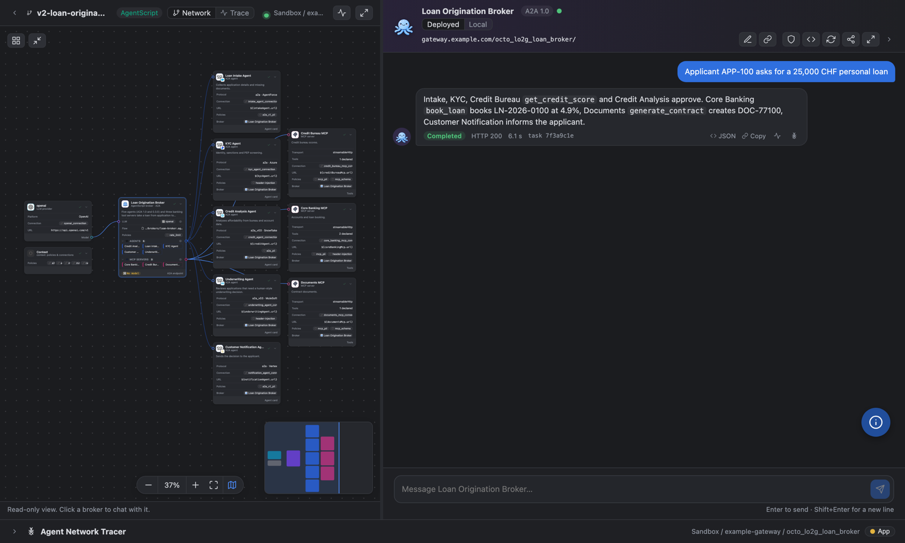

*The reply in the screenshot is an illustration: it shows what the broker answers. The real wording changes from run to run.*

| Prompt | You should see |
|---|---|
| `Applicant APP-100 asks for a 25,000 CHF personal loan` | Intake, KYC, Credit Bureau `get_credit_score` and Credit Analysis approve. Core Banking `book_loan` books LN-2026-0100 at 4.9%, Documents `generate_contract` creates DOC-77100, Customer Notification informs the applicant. |
| `Applicant APP-200 wants 300,000 CHF for a mortgage` | Bureau score 655, debt-to-income 41%: the assessment refers it. Underwriting approves 260,000 CHF with a 20% equity condition. |
| `My email is jane.doe@example.com and my phone is +41 79 123 45 67. Applicant APP-100 asks for a 25,000 CHF personal loan` | Same answer as the first prompt. The PII detector policies log the email and phone number; on the MCP connections with the MCP PII detector they are masked before the tool sees them. Check the policy logs in Anypoint Monitoring. |
| `Send the first prompt more than 30 times within a minute` | The broker answers HTTP 429 (Too Many Requests) once the rate limit of 30 requests per minute is reached. |

The broker is deterministic: the branches are fixed in the flow in `brokers/` (open the `.agent` file to see them). The LLM only reads the ids from your prompt and writes the reply text, so the same input takes the same branch.

### Step 9. Trace a reply

Under each reply, the **Tracer** icon opens the task in the **Agent Network Tracer**: a waterfall of every call the broker made (gateway, broker, LLM, A2A agents, MCP tools) on one time axis, coloured like the cards. Errors are red. Click a span to see its request and response. The **Network** view shows the same reply as a sequence of calls.

### Step 10. Share it (optional)

The **Share** icon in the chat header opens the Share dialog. **A²D sessions** invites people by email to chat with this deployed broker and brings their passed / failed marks and comments back. **Local portal** generates a small web chat you can run or host anywhere.

## Path 3: Build it from scratch

Here you build the same network yourself, starting from a blank project. Every step uses a form, a menu or a button. You never import the template, and you never type YAML or AgentScript. The names below are the template's names without the `octo_lo2g_` prefix. You can use your own names, but keep them consistent.

> The text fields take plain values. Where a value looks like `${group.name}`, type it as shown: it is a **variable** that `exchange.json` declares and that deploy fills in.

### Step 3.1. Create a blank project with a starter broker

Connect Octoloom first, as in [Path 2, Step 1](#step-1-connect-octoloom). Then, on **Home**, click **New Deterministic Network**. In **2 Start from**, choose **Blank** and turn on **Add a starter broker**.

- **Broker name**: `Loan Origination Broker`
- **Name**: `loan-origination-governed-scratch` (the Exchange asset id; a different name from the template, so both can live in one org)
- **Parent folder**: pick a folder, then click **Create blank project**.

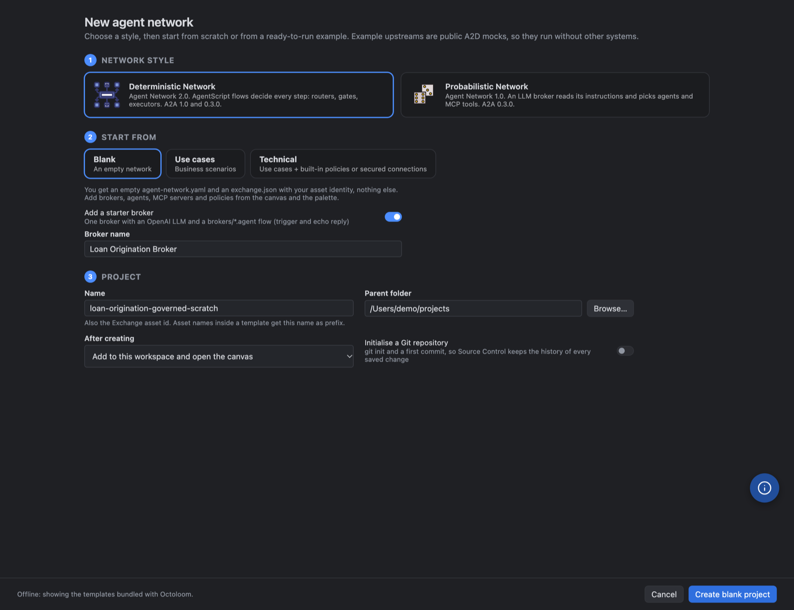

The starter broker `loan_origination_broker` has an OpenAI LLM connection (`openai_connection`, MuleSoft's published OpenAI LLM) and a flow `brokers/loan-origination-broker.agent` with a trigger, one subagent and the built-in `done` reply. The LLM is already done.

### Step 3.2. Add the agents

On the canvas, click **+** (Add to the network) → **Agent** → **Empty**. The new agent opens in the inspector on the right. Fill it in, then repeat for each agent:

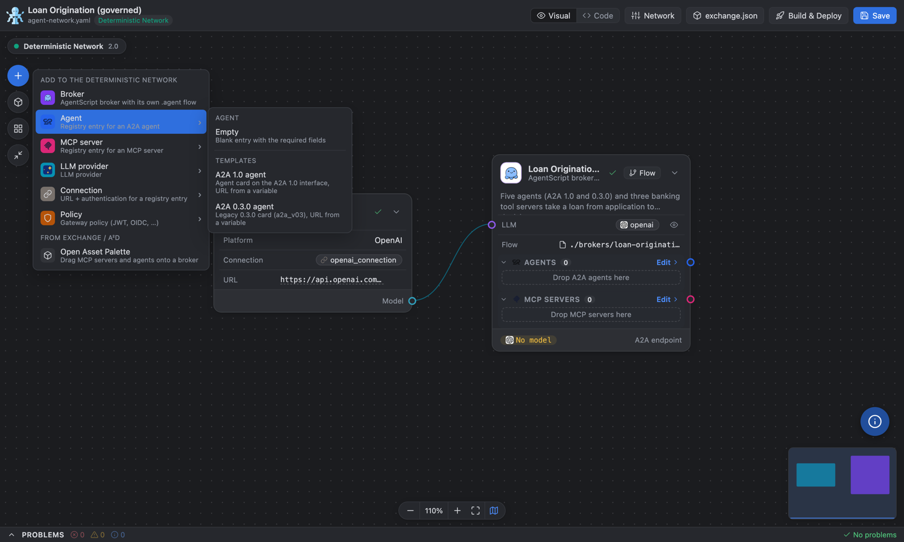

- **Loan Intake Agent**
  - **Identity → Key**: `intake_agent`
  - **Info → Label**: Loan Intake Agent · **Description**: Collects application details and missing documents.
  - **Metadata → Platform**: `AgentForce` (or click its icon under **Agent framework**)
  - **Interface**: click `a2a` (A2A 1.0). **Agent card (A2A 1.x)**: **Name** Loan Intake Agent, **Description** as above, **Supported interfaces → URL** `https://www.a2d-ai.com/api/platform/2ea30f69-75a2-4381-a635-29e555bd4bd3/a2a`, Binding `JSONRPC`, Protocol version `1.0`
- **KYC Agent**
  - **Identity → Key**: `kyc_agent`
  - **Info → Label**: KYC Agent · **Description**: Identity, sanctions and PEP screening.
  - **Metadata → Platform**: `Azure` (or click its icon under **Agent framework**)
  - **Interface**: click `a2a` (A2A 1.0). **Agent card (A2A 1.x)**: **Name** KYC Agent, **Description** as above, **Supported interfaces → URL** `https://www.a2d-ai.com/api/platform/97024288-98ec-4586-92b6-13b6f0f74a72/a2a`, Binding `JSONRPC`, Protocol version `1.0`
- **Credit Analysis Agent**
  - **Identity → Key**: `credit_agent`
  - **Info → Label**: Credit Analysis Agent · **Description**: Analyses affordability from bureau and account data.
  - **Metadata → Platform**: `Snowflake` (or click its icon under **Agent framework**)
  - **Interface**: keep `a2a_v03` (A2A 0.3.0). **Agent card (A2A 0.3)**: **Name** Credit Analysis Agent, **Description** as above, **URL** `https://www.a2d-ai.com/api/platform/6a1f14e9-59ea-411e-9d81-c90b1ebd5ca5/a2a`
- **Underwriting Agent**
  - **Identity → Key**: `underwriting_agent`
  - **Info → Label**: Underwriting Agent · **Description**: Reviews applications that need a human-style underwriting decision.
  - **Metadata → Platform**: `MuleSoft` (or click its icon under **Agent framework**)
  - **Interface**: keep `a2a_v03` (A2A 0.3.0). **Agent card (A2A 0.3)**: **Name** Underwriting Agent, **Description** as above, **URL** `https://www.a2d-ai.com/api/platform/5da083cf-f7d6-49e5-897b-234894062950/a2a`
- **Customer Notification Agent**
  - **Identity → Key**: `notification_agent`
  - **Info → Label**: Customer Notification Agent · **Description**: Sends the decision to the applicant.
  - **Metadata → Platform**: `Vertex` (or click its icon under **Agent framework**)
  - **Interface**: click `a2a` (A2A 1.0). **Agent card (A2A 1.x)**: **Name** Customer Notification Agent, **Description** as above, **Supported interfaces → URL** `https://www.a2d-ai.com/api/platform/7e50ef53-bf45-4efb-b816-165f22551a1d/a2a`, Binding `JSONRPC`, Protocol version `1.0`

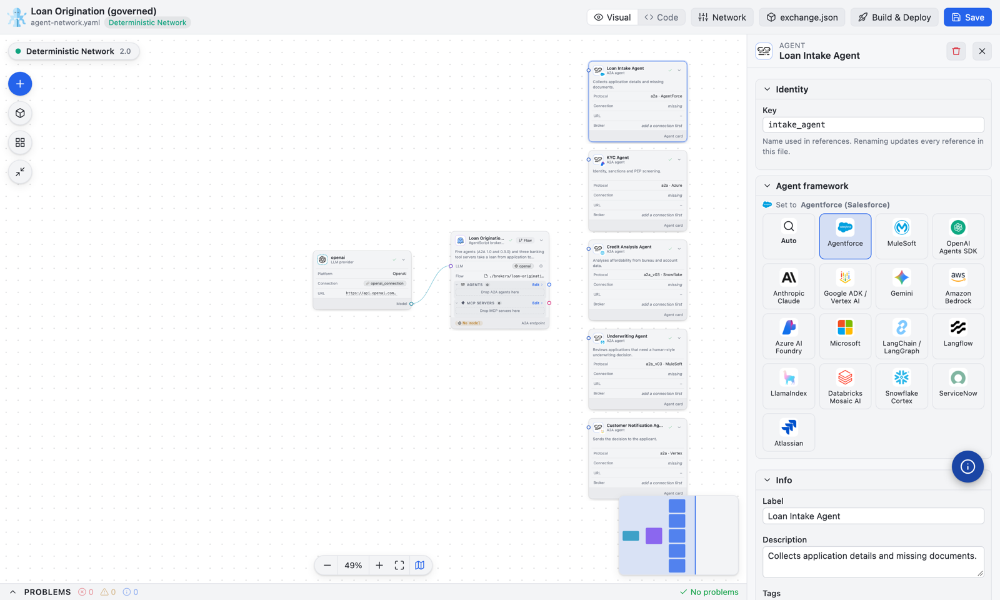

The card skills are optional. Once the agent has a connection (two steps on), the inspector offers **Read skills from the live agent**, which fills them from the running agent.

### Step 3.3. Add the MCP servers

Click **+** → **MCP server** → **Empty**, then fill in:

- **Credit Bureau MCP**: **Key** `credit_bureau_mcp`, **Label** Credit Bureau MCP, **Description** Credit bureau scores · **Protocol version** `2025-06-18`. The transport is already Streamable HTTP on `/mcp`.
- **Core Banking MCP**: **Key** `core_banking_mcp`, **Label** Core Banking MCP, **Description** Accounts and loan booking · **Protocol version** `2025-06-18`. The transport is already Streamable HTTP on `/mcp`.
- **Documents MCP**: **Key** `documents_mcp`, **Label** Documents MCP, **Description** Contract documents · **Protocol version** `2025-06-18`. The transport is already Streamable HTTP on `/mcp`.

### Step 3.4. Add the connections

A connection is the URL (and authentication) Agent Fabric uses to reach an agent or an MCP server. Click **+** → **Connection** → **Empty** once per agent and MCP server, and fill in:

| Key | Kind | Registry entry → Name | URL |
|---|---|---|---|
| `intake_agent_connection` | `a2a` | `intake_agent` | `${intakeAgent.url}` |
| `kyc_agent_connection` | `a2a` | `kyc_agent` | `${kycAgent.url}` |
| `credit_agent_connection` | `a2a` | `credit_agent` | `${creditAgent.url}` |
| `underwriting_agent_connection` | `a2a` | `underwriting_agent` | `${underwritingAgent.url}` |
| `notification_agent_connection` | `a2a` | `notification_agent` | `${notificationAgent.url}` |
| `credit_bureau_mcp_connection` | `mcp` | `credit_bureau_mcp` | `${creditBureauMcp.url}` |
| `core_banking_mcp_connection` | `mcp` | `core_banking_mcp` | `${coreBankingMcp.url}` |
| `documents_mcp_connection` | `mcp` | `documents_mcp` | `${documentsMcp.url}` |

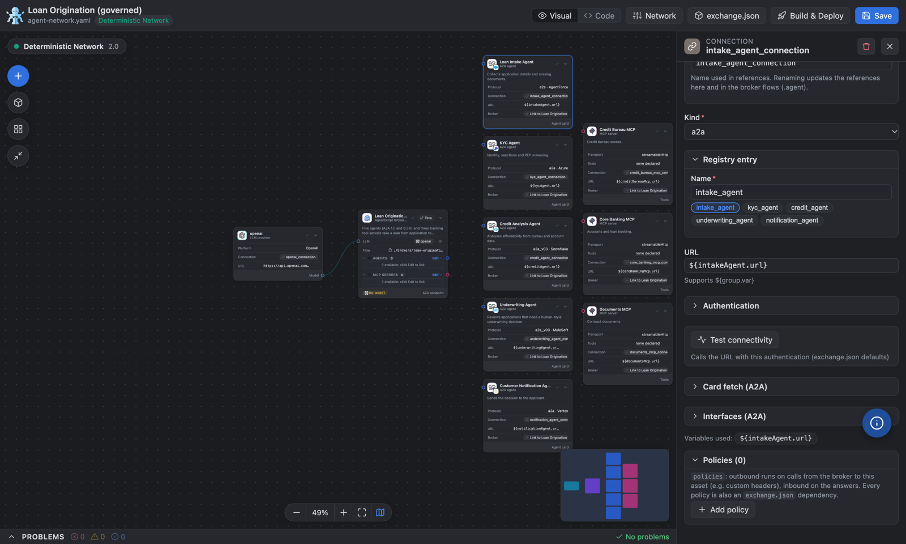

### Step 3.5. Declare the variables

The Problems bar now shows **Variable ${…} is not declared in exchange.json** for each new variable. Click **Add to exchange.json** on each one.

Then open `exchange.json` (it opens as a form) and, under **Variables**, set the defaults:

| Variable | Default |
|---|---|
| `intakeAgent.url` | `https://www.a2d-ai.com/api/platform/2ea30f69-75a2-4381-a635-29e555bd4bd3/a2a` |
| `kycAgent.url` | `https://www.a2d-ai.com/api/platform/97024288-98ec-4586-92b6-13b6f0f74a72/a2a` |
| `creditAgent.url` | `https://www.a2d-ai.com/api/platform/6a1f14e9-59ea-411e-9d81-c90b1ebd5ca5/a2a` |
| `underwritingAgent.url` | `https://www.a2d-ai.com/api/platform/5da083cf-f7d6-49e5-897b-234894062950/a2a` |
| `notificationAgent.url` | `https://www.a2d-ai.com/api/platform/7e50ef53-bf45-4efb-b816-165f22551a1d/a2a` |
| `creditBureauMcp.url` | `https://www.a2d-ai.com/api/platform/c41e39ee-96a3-4e06-b5fe-c7fb4b4d7e67/` |
| `coreBankingMcp.url` | `https://www.a2d-ai.com/api/platform/07001b9c-9654-4d45-a016-31eb73dd5a5d/` |
| `documentsMcp.url` | `https://www.a2d-ai.com/api/platform/80adaf50-d7fe-48dc-807c-2ebddd187893/` |

Leave the secret variables (`openai.apiKey`) empty: deploy asks for them and never stores them.

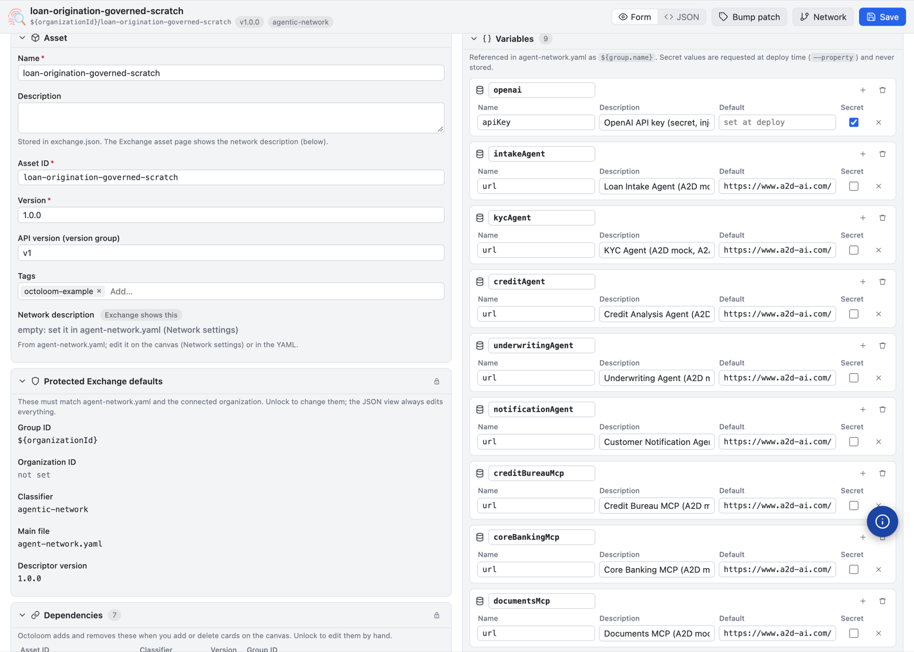

Also click **Remove it** on any **declared but not used** variable that the Problems bar shows.

### Step 3.6. Declare the MCP tools

On each MCP server card, click the **Tools** row (or its pencil). Octoloom reads the tool list from the running server: tick the tools below. You can also type a name in **Add a tool by name…**.

- **Credit Bureau MCP**: `get_credit_score`
- **Core Banking MCP**: `get_accounts`, `book_loan`
- **Documents MCP**: `generate_contract`

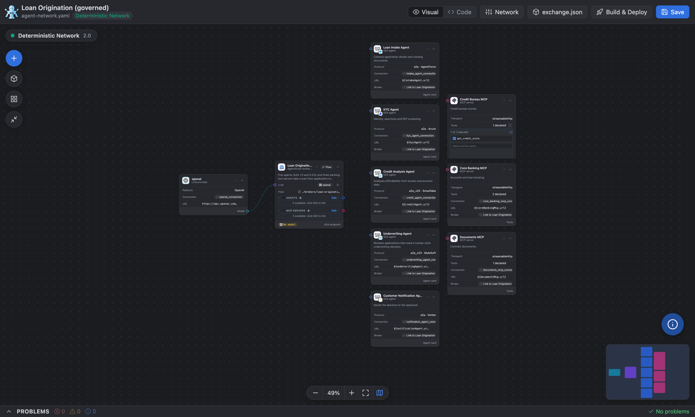

### Step 3.7. Link the agents and MCP servers to the broker

Every agent and MCP card now has a **Broker** row with **Link to Loan Origination Broker**. Click it on each card. Octoloom adds the matching actions to the broker flow: one per agent and one per declared MCP tool.

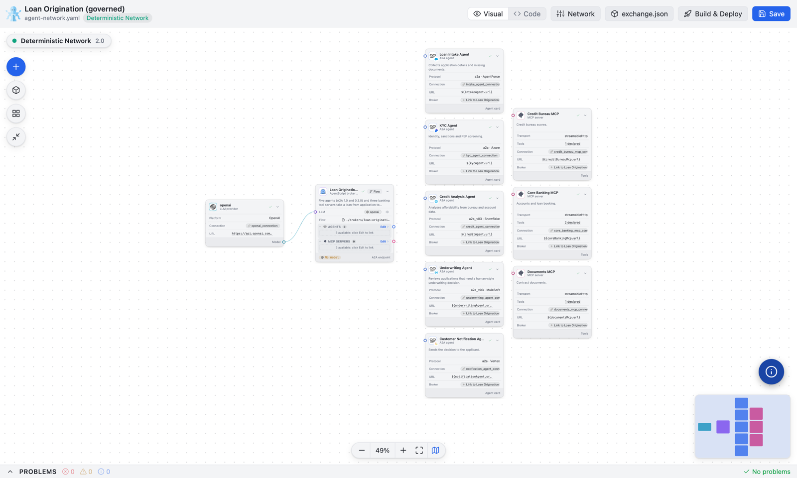

**Link to** also reads the required inputs from the tool schema. In the flow (next step), open **Connections** in the explorer and check that these actions show them under **Inputs** (one per line; type them if they are missing):
- `book_loan`: `applicant_id: string`, `amount: number`

### Step 3.8. Build the broker flow

On the broker card (or in its inspector), click **Open broker flow**. Then set up the flow:

1. **Settings → Language Settings**: on the `default` model, set **Reasoning effort (OpenAI)** to `MINIMAL`.
2. **Settings → System Messages**: set the instructions to: *You are a loan origination desk. Decisions follow the credit data; never promise an approval before the assessment.*
3. Select the `assistant` subagent and delete it (trash icon). The trigger and the built-in `done` reply stay.
4. Add the steps below in order. Select the step that comes before, click **Add node**, pick the kind and choose **Empty**, then set its **API name** in **General**. Octoloom wires each new step after the selected one, and you set the exact next step in the inspector.

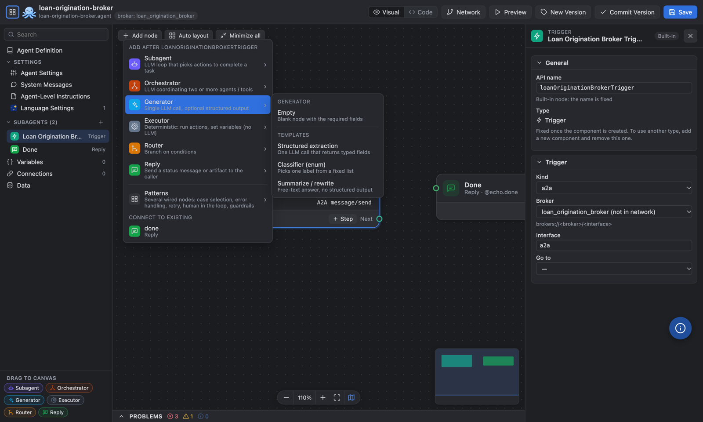

Select the trigger and, under **Go to**, pick `progressParseApplication` once that step exists.

#### Generator `parseApplication`

- **Label** Parse Application · **Description** Extracts applicant, amount and product.
- **System instructions**:

  > Extract the applicant id (for example APP-100), the requested amount in CHF as a number, and the product.
  > Product is "mortgage" for property financing, otherwise "personal".

- **Prompt**:

  > {!@request.payload.message.parts[0].text}

- **Structured output** (**Add field** for each):
  - `applicant_id` (string): Applicant id, e.g. APP-100
  - `amount` (number): Requested amount in CHF
  - `product` (string): Loan product · **Allowed values** `personal`, `mortgage`
- **Next step (on exit) → Go to**: `progressAssess`

#### Orchestrator `assess`

- **Label** Assess Application · **Description** Runs intake, KYC and the credit analysis.
- **System instructions**:

  > Run intake, KYC and the credit analysis, and read the bureau score and the accounts.
  > Decision rules: "approve" when KYC passed, score >= 700 and debt-to-income <= 35%.
  > "refer" when KYC passed but the score or affordability is borderline. "decline" when KYC fails.

- **Reasoning instructions**:

  > Applicant {!@generator.parseApplication.output.applicant_id} requests {!@generator.parseApplication.output.amount} CHF ({!@generator.parseApplication.output.product}).

- **Actions** (**+ Add action…**): `intake_agent`, `kyc_agent`, `credit_agent`, `get_credit_score`, `get_accounts`
- **Limits → Max loops**: `8`
- **Structured output** (**Add field** for each):
  - `decision` (string): Assessment decision · **Allowed values** `approve`, `refer`, `decline`
  - `summary` (string): Reasons for the decision
- **Next step (on exit) → Go to**: `decisionRouter`

#### Router `decisionRouter`

- **Description** Approve books the loan, refer goes to underwriting, decline notifies.
- **Routes** (**+**): **Label** Approve · **When** `@orchestrator.assess.output.decision == "approve"` · **Go to** `progressBookLoan`
- **Routes** (**+**): **Label** Refer · **When** `@orchestrator.assess.output.decision == "refer"` · **Go to** `progressUnderwrite`
- **Otherwise → Go to**: `progressNotifyDecline`

#### Executor `bookLoan`

- **Description** Books the approved loan.
- **Steps (do)**: **Run action**
  - **Action** `book_loan`
    - **Bind argument** `applicant_id` = `@generator.parseApplication.output.applicant_id`
    - **Bind argument** `amount` = `@generator.parseApplication.output.amount`
- **Next step (on exit) → Go to**: `progressNotifyApproval`

#### Subagent `notifyApproval`

- **Label** Notify Approval · **Description** Generates the contract and notifies the applicant.
- **Reasoning instructions**:

  > The loan for {!@generator.parseApplication.output.applicant_id} is booked. Generate the contract and notify the applicant.

- **Actions** (**+ Add action…**): `generate_contract`, `notification_agent`
- **Next step (on exit) → Go to**: `approved`

#### Reply `approved`

- **Use expression**, then **Message (expression)**: `"Approved: " + @orchestrator.assess.output.summary + " " + @subagent.notifyApproval.output`
- **Task state**: `TASK_STATE_COMPLETED`

#### Subagent `underwrite`

- **Label** Underwriting · **Description** Sends borderline applications to underwriting.
- **Reasoning instructions**:

  > Underwrite application of {!@generator.parseApplication.output.applicant_id}: {!@orchestrator.assess.output.summary}

- **Actions** (**+ Add action…**): `underwriting_agent`
- **Next step (on exit) → Go to**: `underwritten`

#### Reply `underwritten`

- **Use expression**, then **Message (expression)**: `@subagent.underwrite.output`
- **Task state**: `TASK_STATE_COMPLETED`

#### Subagent `notifyDecline`

- **Label** Notify Decline · **Description** Notifies the applicant of a decline.
- **Reasoning instructions**:

  > Notify {!@generator.parseApplication.output.applicant_id} that the application was declined: {!@orchestrator.assess.output.summary}

- **Actions** (**+ Add action…**): `notification_agent`
- **Next step (on exit) → Go to**: `declined`

#### Reply `declined`

- **Use expression**, then **Message (expression)**: `"Declined: " + @orchestrator.assess.output.summary`
- **Task state**: `TASK_STATE_COMPLETED`

#### Reply `progressParseApplication`

- **Message text**: Extracting applicant, amount and product...
- **Task state**: `TASK_STATE_WORKING` (a progress update: the chat shows it while the broker works, then the flow goes on)
- **Next step (on exit) → Go to**: `parseApplication`

#### Reply `progressAssess`

- **Message text**: Running intake, KYC and the credit analysis...
- **Task state**: `TASK_STATE_WORKING` (a progress update: the chat shows it while the broker works, then the flow goes on)
- **Next step (on exit) → Go to**: `assess`

#### Reply `progressBookLoan`

- **Message text**: Booking the approved loan...
- **Task state**: `TASK_STATE_WORKING` (a progress update: the chat shows it while the broker works, then the flow goes on)
- **Next step (on exit) → Go to**: `bookLoan`

#### Reply `progressNotifyApproval`

- **Message text**: Generating the contract and notifying the applicant...
- **Task state**: `TASK_STATE_WORKING` (a progress update: the chat shows it while the broker works, then the flow goes on)
- **Next step (on exit) → Go to**: `notifyApproval`

#### Reply `progressUnderwrite`

- **Message text**: Sending borderline applications to underwriting...
- **Task state**: `TASK_STATE_WORKING` (a progress update: the chat shows it while the broker works, then the flow goes on)
- **Next step (on exit) → Go to**: `underwrite`

#### Reply `progressNotifyDecline`

- **Message text**: Notifying the applicant of a decline...
- **Task state**: `TASK_STATE_WORKING` (a progress update: the chat shows it while the broker works, then the flow goes on)
- **Next step (on exit) → Go to**: `notifyDecline`

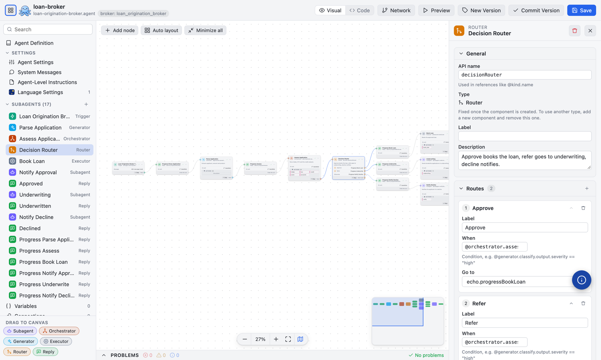

When you are done, the flow matches the template's flow ([Path 2, Step 4](#step-4-follow-the-broker-flow-agentscript)). The built-in `done` reply isn't used by this use case. The Problems bar shows **echo done is not reachable from the trigger** as a warning, and you can leave it.

### Step 3.9. Add the policies

Select the broker or connection, scroll to **Policies** and click **Add policy**. Pick the policy (search by name), choose the **Direction** and set its **Configuration** fields. **Header Injection** has its own header list. Octoloom also adds each policy as an `exchange.json` dependency.

- Broker `loan_origination_broker`: **Rate Limiting** (inbound)
  - **rateLimits** (one entry each, **+**): maximumRequests `30`, timePeriodInMilliseconds `60000`
  - **exposeHeaders**: on
- Connection `intake_agent_connection`: **A2A v1 PII Detector** (inbound)
  - **entities**: `Email`, `US SSN`, `Credit Card`
  - **action**: `Log`
- Connection `kyc_agent_connection`: **Header Injection** (inbound)
  - **inboundHeaders** (one entry each, **+**): `x-correlation-source` = `loan_broker`
- Connection `credit_agent_connection`: **A2A PII Detector** (inbound)
  - **entities**: `Email`, `US SSN`, `Credit Card`
  - **action**: `Log`
- Connection `underwriting_agent_connection`: **Header Injection** (inbound)
  - **inboundHeaders** (one entry each, **+**): `x-correlation-source` = `loan_broker`
- Connection `notification_agent_connection`: **A2A v1 PII Detector** (inbound)
  - **entities**: `Email`, `US SSN`, `Credit Card`
  - **action**: `Log`
- Connection `credit_bureau_mcp_connection`: **MCP PII Detector** (inbound)
  - **entities**: `Email`, `US SSN`, `Credit Card`, `Phone Number`
  - **action**: `Log and mask`
- Connection `credit_bureau_mcp_connection`: **MCP Schema Validation** (inbound)
  - **validateToolSchema**: on
- Connection `core_banking_mcp_connection`: **MCP PII Detector** (inbound)
  - **entities**: `Email`, `US SSN`, `Credit Card`, `Phone Number`
  - **action**: `Log and mask`
- Connection `core_banking_mcp_connection`: **Header Injection** (inbound)
  - **inboundHeaders** (one entry each, **+**): `x-octoloom-source` = `loan-origination-governed-v2`
- Connection `documents_mcp_connection`: **MCP PII Detector** (inbound)
  - **entities**: `Email`, `US SSN`, `Credit Card`, `Phone Number`
  - **action**: `Log and mask`
- Connection `documents_mcp_connection`: **MCP Schema Validation** (inbound)
  - **validateToolSchema**: on

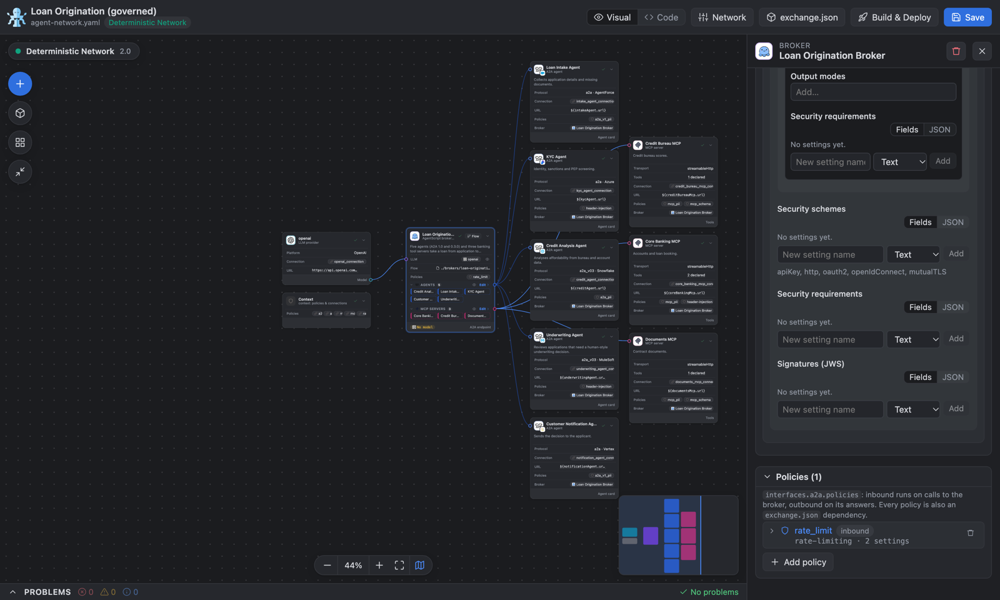

The template declares a policy once under `context.policies` and points to it from each connection. **Add policy** writes each policy on its connection instead. Both give the same result at runtime.

### Step 3.10. Validate, deploy and chat

Run **Validate** from the canvas CLI menu and fix anything in the Problems bar. Then follow Path 2 from [Validate and build](#step-5-validate-and-build) onwards: deploy (enter the secrets), wait for the green light, open the chat and send the same prompts. Your network answers like the template, because it is the same network, built by hand.

## What you learned

- How a deterministic network is built: an AgentScript flow decides every step; the LLM extracts and writes text.
- How the canvas, the inspector and the code view edit the same YAML.
- How to build the same network from a blank project with forms and menus only (Path 3).
- How policies are attached and checked with Governance.
- How to validate, build, deploy, chat and trace with Octoloom.

## Next

- Previous: [KYC / AML Onboarding: governed](../v2-kyc-onboarding-governed/README.md)
- Next: [Marketing Campaign Studio: governed](../v2-campaign-studio-governed/README.md)
- Same use case, plain variant: [Loan Origination](../v2-loan-origination/README.md)
- [All tutorials](../README.md)

---
Generated from the `v2-loan-origination-governed` template (Octoloom `media/templates/v2-loan-origination-governed`). Screenshots use fake data.
