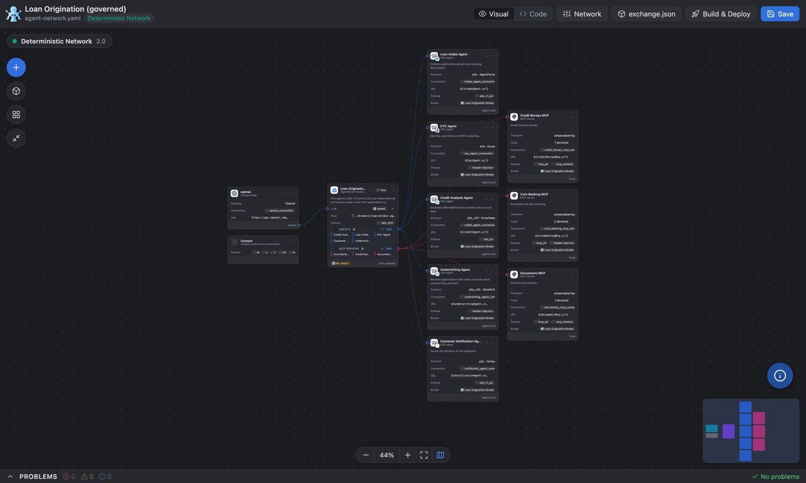

# Tutorial: Loan Origination: governed

[All tutorials](../README.md) · [Getting started](../getting-started.md) · Deterministic network (Agent Network 2.0, AgentScript) · Technical · governed

> Five agents (A2A 1.0 and 0.3.0) and three banking tool servers take a loan from application to decision. Adds built-in policies: a2a-v1-pii-detector, header-injection, a-two-a-pii-detector, mcp-pii-detector, mcp-schema-validation, rate-limiting.

| Agents | MCP servers | A2A | Policies | Template id |
|---|---|---|---|---|
| 5 | 3 | 1.0, 0.3.0 | 6 | `v2-loan-origination-governed` |

There are two ways to use this template:

1. **[Just use it](#path-1-just-use-it)**: create the project, deploy it and chat with it in about 10 minutes.
2. **[Learn step by step](#path-2-learn-step-by-step)**: the same steps, with what each part of the network does and how Octoloom shows it.

## Before you start

- VS Code with **Octoloom for Agent Fabric** installed (Marketplace), version 0.9.25 or later.
- An Anypoint organization with Agent Fabric, a connected app (client ID and secret), an environment and a Flex gateway.
- An OpenAI API key (or an OpenAI-compatible LLM gateway).
- Nothing else: all agents and MCP servers are public A²D mocks, so the network runs without any other system.

## Path 1: Just use it

1. **Home → Start → New Deterministic Network.** In the dialog pick **Technical**, then the card **Loan Origination** (the one with the policies chip). Choose a folder and click **Create**.
2. **Deploy.** In **Projects & Deploy**, click **Deploy** on this project (or **Build & Deploy** in the editor) and pick your gateway. Octoloom asks for each secret variable; nothing you type is stored:
   - `openai.apiKey`: OpenAI API key (secret, injected at deploy time)
3. **Chat.** When the status light is green, click **Open chat** and paste:
   - `Applicant APP-100 asks for a 25,000 CHF personal loan`
   - `Applicant APP-200 wants 300,000 CHF for a mortgage`
   - `My email is jane.doe@example.com and my phone is +41 79 123 45 67. Applicant APP-100 asks for a 25,000 CHF personal loan`
   - `Send the first prompt more than 30 times within a minute`

Done. The rest of this page explains what you just ran.

## Path 2: Learn step by step

### Step 1. Connect Octoloom

Open **Setup & Connect** (Octoloom side bar) and connect **Agent Fabric**: the connected app client ID and secret and the organization. Pick the environment. A²D isn't needed: the mock URLs are already the defaults in `exchange.json`. The Tooling list shows Node.js, Java and anypoint-cli-v4 with its agent-network plugin. Use **Install** or **Repair** on any red row.

### Step 2. Create the project from the template

On **Home**, click **New Deterministic Network**. In **2 Start from**, choose **Technical** and click **Loan Origination**. The right side shows the template README: what it contains, **Deploy in 3 steps** and **Try it**. Keep the suggested name `loan-origination-governed` or type your own, pick the folder and click **Create**.

Octoloom writes `agent-network.yaml`, `exchange.json`, `README.md` and the broker flow in `brokers/`, and opens the canvas. Every id gets the template prefix `octo_lo2g_`, so several templates can be deployed into one org side by side.

### Step 3. Read the network on the canvas

Each card is a part of `agent-network.yaml`. Click one to open it in the inspector on the right. Each change in the inspector is a change to the text, so the YAML stays the source of truth (**Code** view shows it).

- **Broker Loan Origination Broker** (`octo_lo2g_loan_broker`): its AgentScript flow decides every step.
- **Agent Loan Intake Agent**: Collects application details and missing documents.
- **Agent KYC Agent**: Identity, sanctions and PEP screening.
- **Agent Credit Analysis Agent**: Analyses affordability from bureau and account data.
- **Agent Underwriting Agent**: Reviews applications that need a human-style underwriting decision.
- **Agent Customer Notification Agent**: Sends the decision to the applicant.
- **MCP server Credit Bureau MCP**: Credit bureau scores. Tools: `get_credit_score`.
- **MCP server Core Banking MCP**: Accounts and loan booking. Tools: `get_accounts`, `book_loan`.
- **MCP server Documents MCP**: Contract documents. Tools: `generate_contract`.

Try this on the canvas: use the zoom bar and the minimap, drag a card, or **Auto layout**. The layout is saved per file. **Minimize all** turns the cards into icon tiles. Click a connection line to see which broker uses which agent or tool.

### Step 4. Follow the broker flow (AgentScript)

Double-click the broker card (or open `brokers/loan-broker.agent`). The flow editor shows the AgentScript program that decides every step. The LLM only extracts fields and writes text, so the same input always takes the same branch.

| Step | Kind | What it does |
|---|---|---|
| `loanBrokerTrigger` | Trigger | Starts the flow when an A2A message arrives at the broker. |
| `parseApplication` | Generator | Extracts applicant, amount and product. |
| `assess` | Orchestrator | Runs intake, KYC and the credit analysis. |
| `decisionRouter` | Router | Approve books the loan, refer goes to underwriting, decline notifies. |
| `bookLoan` | Executor | Books the approved loan. |
| `notifyApproval` | Subagent | Generates the contract and notifies the applicant. |
| `approved` | Echo | Ends the flow with the `approved` reply. |
| `underwrite` | Subagent | Sends borderline applications to underwriting. |
| `underwritten` | Echo | Ends the flow with the `underwritten` reply. |
| `notifyDecline` | Subagent | Notifies the applicant of a decline. |
| `declined` | Echo | Ends the flow with the `declined` reply. |

Click a step to edit it in the inspector. **+ Step** adds a node, and **+ Step → Patterns** inserts whole shapes such as retry, human in the loop or a guardrail check. **Code** shows the `.agent` text with completion.

### Step 5. See the policies

This variant adds Agent Fabric policies. Open a broker or connection and look at its **Policies** section. Each policy folds open to show its configuration:
- `a2a-v1-pii-detector`
- `header-injection`
- `a-two-a-pii-detector`
- `mcp-pii-detector`
- `mcp-schema-validation`
- `rate-limiting`

Run **Governance** (shield icon in the canvas toolbar) to check the project against the Agent Fabric rulesets. It runs locally, and findings show on the cards with **Fix** where one exists.

### Step 6. Validate and build

In the canvas toolbar, open the CLI menu: **Validate** does a dry run of build, publish and deploy and lists problems in the Problems panel (click one to jump to the card). **Build** repairs and packages the project locally with anypoint-cli-v4.

The variables of this template (in `exchange.json`, open it for the no-code form):

| Variable | What | Default |
|---|---|---|
| `intakeAgent.url` | Loan Intake Agent (A2D mock, A2A 1.0) URL | `https://www.a2d-ai.com/api/platform/2ea30f69-75a2-4381-a635-29e555bd4bd3/a2a` |
| `kycAgent.url` | KYC Agent (A2D mock, A2A 1.0) URL | `https://www.a2d-ai.com/api/platform/97024288-98ec-4586-92b6-13b6f0f74a72/a2a` |
| `creditAgent.url` | Credit Analysis Agent (A2D mock, A2A 0.3.0) URL | `https://www.a2d-ai.com/api/platform/6a1f14e9-59ea-411e-9d81-c90b1ebd5ca5/a2a` |
| `underwritingAgent.url` | Underwriting Agent (A2D mock, A2A 0.3.0) URL | `https://www.a2d-ai.com/api/platform/5da083cf-f7d6-49e5-897b-234894062950/a2a` |
| `notificationAgent.url` | Customer Notification Agent (A2D mock, A2A 1.0) URL | `https://www.a2d-ai.com/api/platform/7e50ef53-bf45-4efb-b816-165f22551a1d/a2a` |
| `creditBureauMcp.url` | Credit Bureau MCP (A2D mock) base URL | `https://www.a2d-ai.com/api/platform/c41e39ee-96a3-4e06-b5fe-c7fb4b4d7e67/` |
| `coreBankingMcp.url` | Core Banking MCP (A2D mock) base URL | `https://www.a2d-ai.com/api/platform/07001b9c-9654-4d45-a016-31eb73dd5a5d/` |
| `documentsMcp.url` | Documents MCP (A2D mock) base URL | `https://www.a2d-ai.com/api/platform/80adaf50-d7fe-48dc-807c-2ebddd187893/` |

### Step 7. Deploy

Open **Projects & Deploy** and click **Deploy** on the project (or **Deploy…** on the canvas). Pick your gateway (the chips show its status and space), keep **Tracing**, **Wait until the network is ready** and **Publish before deploy** on, then enter the secrets. Nothing you type is stored:

- `openai.apiKey`: OpenAI API key (secret, injected at deploy time)

The square status light goes from blue (deploying) to green (**Deployed and running**). The deployment box lists every broker URL; click one to copy it.

### Step 8. Chat with the broker

Click **Open chat** on the deployment box. On the left is the network (the cards light up as they are called), and on the right is the conversation with its task states. Paste the prompts one at a time:

*The reply in the screenshot is an illustration: it shows what the broker answers. The real wording changes from run to run.*

| Prompt | You should see |
|---|---|
| `Applicant APP-100 asks for a 25,000 CHF personal loan` | Intake, KYC, Credit Bureau `get_credit_score` and Credit Analysis approve. Core Banking `book_loan` books LN-2026-0100 at 4.9%, Documents `generate_contract` creates DOC-77100, Customer Notification informs the applicant. |
| `Applicant APP-200 wants 300,000 CHF for a mortgage` | Bureau score 655, debt-to-income 41%: the assessment refers it. Underwriting approves 260,000 CHF with a 20% equity condition. |
| `My email is jane.doe@example.com and my phone is +41 79 123 45 67. Applicant APP-100 asks for a 25,000 CHF personal loan` | Same answer as the first prompt. The PII detector policies log the email and phone number; on the MCP connections with the MCP PII detector they are masked before the tool sees them. Check the policy logs in Anypoint Monitoring. |
| `Send the first prompt more than 30 times within a minute` | The broker answers HTTP 429 (Too Many Requests) once the rate limit of 30 requests per minute is reached. |

The broker is deterministic: the branches are fixed in the flow in `brokers/` (open the `.agent` file to see them). The LLM only reads the ids from your prompt and writes the reply text, so the same input takes the same branch.

### Step 9. Trace a reply

Under each reply, the **Tracer** icon opens the task in the **Agent Network Tracer**: a waterfall of every call the broker made (gateway, broker, LLM, A2A agents, MCP tools) on one time axis, coloured like the cards. Errors are red. Click a span to see its request and response. The **Network** view shows the same reply as a sequence of calls.

### Step 10. Share it (optional)

The **Share** icon in the chat header opens the Share dialog. **A²D sessions** invites people by email to chat with this deployed broker and brings their passed / failed marks and comments back. **Local portal** generates a small web chat you can run or host anywhere.

## What you learned

- How a deterministic network is built: an AgentScript flow decides every step; the LLM extracts and writes text.
- How the canvas, the inspector and the code view edit the same YAML.
- How policies are attached and checked with Governance.
- How to validate, build, deploy, chat and trace with Octoloom.

## Next

- Previous: [KYC / AML Onboarding: governed](../v2-kyc-onboarding-governed/README.md)
- Next: [Marketing Campaign Studio: governed](../v2-campaign-studio-governed/README.md)
- Same use case, plain variant: [Loan Origination](../v2-loan-origination/README.md)
- [All tutorials](../README.md)

---
Generated from the `v2-loan-origination-governed` template (Octoloom `media/templates/v2-loan-origination-governed`). Screenshots use fake data.
