# Tutorial: Retail Returns

[All tutorials](../README.md) · [Getting started](../getting-started.md) · Deterministic network (Agent Network 2.0, AgentScript) · Use case

> The smallest deterministic flow: extract the order, check eligibility, create the RMA and refund.

| Agents | MCP servers | A2A | Policies | Template id |
|---|---|---|---|---|
| 2 | 1 | 1.0, 0.3.0 | 0 | `v2-retail-returns` |

There are three ways to use this template:

1. **[Just use it](#path-1-just-use-it)**: create the project, deploy it and chat with it in about 10 minutes.
2. **[Learn step by step](#path-2-learn-step-by-step)**: the same steps, with what each part of the network does and how Octoloom shows it.
3. **[Build it from scratch](#path-3-build-it-from-scratch)**: start from a blank project and build the same network yourself, no code, one screenshot per step.

## Before you start

- VS Code with **Octoloom for Agent Fabric** installed (Marketplace), version 0.9.25 or later.
- An Anypoint organization with Agent Fabric, a connected app (client ID and secret), an environment and a Flex gateway.
- An OpenAI API key (or an OpenAI-compatible LLM gateway).
- Nothing else: all agents and MCP servers are public A²D mocks, so the network runs without any other system.

## Path 1: Just use it

1. **Home → Start → New Deterministic Network.** In the dialog pick **Use cases**, then the card **Retail Returns**. Choose a folder and click **Create**.
2. **Deploy.** In **Projects & Deploy**, click **Deploy** on this project (or **Build & Deploy** in the editor) and pick your gateway. Octoloom asks for each secret variable; nothing you type is stored:
   - `openai.apiKey`: OpenAI API key (secret, injected at deploy time)
3. **Chat.** When the status light is green, click **Open chat** and paste:
   - `I want to return order ORD-1001, the jacket is too small`
   - `Return ORD-1002 please`
   - `Return ORD-9999`

Done. The rest of this page explains what you just ran.

## Path 2: Learn step by step

### Step 1. Connect Octoloom

Open **Setup & Connect** (Octoloom side bar) and connect **Agent Fabric**: the connected app client ID and secret and the organization. Pick the environment. A²D isn't needed: the mock URLs are already the defaults in `exchange.json`. The Tooling list shows Node.js, Java and anypoint-cli-v4 with its agent-network plugin. Use **Install** or **Repair** on any red row.

### Step 2. Create the project from the template

On **Home**, click **New Deterministic Network**. In **2 Start from**, choose **Use cases** and click **Retail Returns**. The right side shows the template README: what it contains, **Deploy in 3 steps** and **Try it**. Keep the suggested name `retail-returns` or type your own, pick the folder and click **Create**.

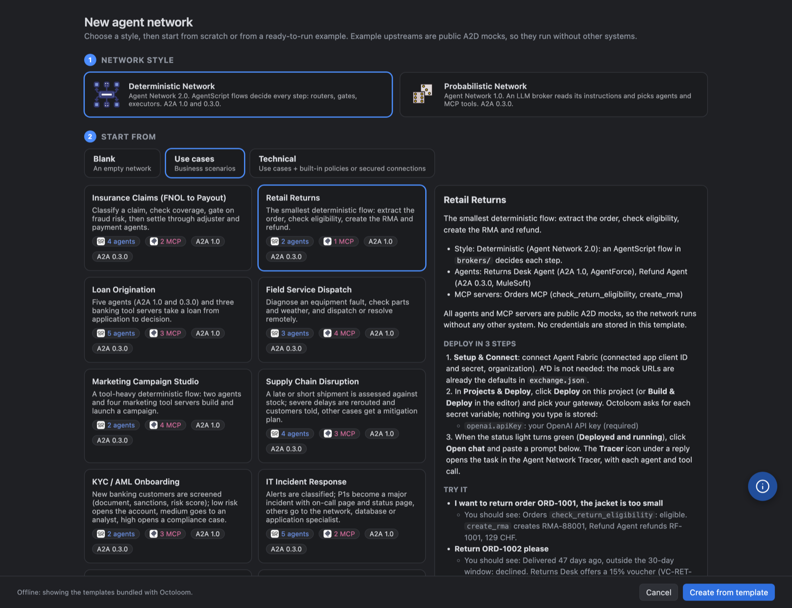

Octoloom writes `agent-network.yaml`, `exchange.json`, `README.md` and the broker flow in `brokers/`, and opens the canvas. Every id gets the template prefix `octo_rr2_`, so several templates can be deployed into one org side by side.

### Step 3. Read the network on the canvas

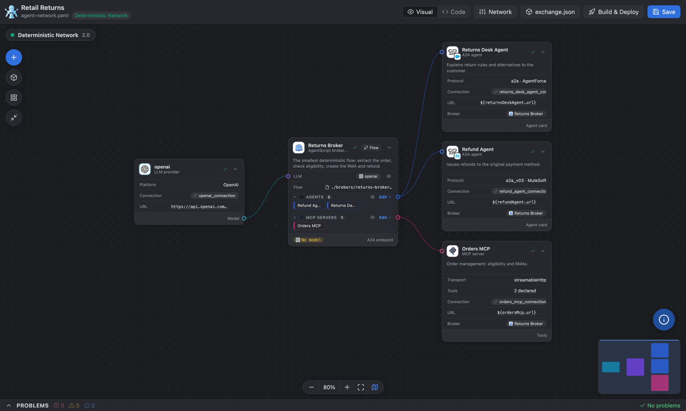

Each card is a part of `agent-network.yaml`. Click one to open it in the inspector on the right. Each change in the inspector is a change to the text, so the YAML stays the source of truth (**Code** view shows it).

- **Broker Returns Broker** (`octo_rr2_returns_broker`): its AgentScript flow decides every step.
- **Agent Returns Desk Agent**: Explains return rules and alternatives to the customer.
- **Agent Refund Agent**: Issues refunds to the original payment method.
- **MCP server Orders MCP**: Order management: eligibility and RMAs. Tools: `check_return_eligibility`, `create_rma`.

Try this on the canvas: use the zoom bar and the minimap, drag a card, or **Auto layout**. The layout is saved per file. **Minimize all** turns the cards into icon tiles. Click a connection line to see which broker uses which agent or tool.

### Step 4. Follow the broker flow (AgentScript)

Double-click the broker card (or open `brokers/returns-broker.agent`). The flow editor shows the AgentScript program that decides every step. The LLM only extracts fields and writes text, so the same input always takes the same branch.

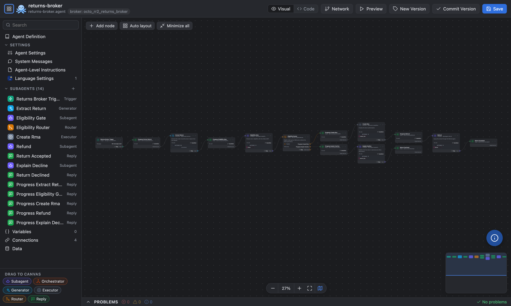

| Step | Kind | What it does |
|---|---|---|
| `returnsBrokerTrigger` | Trigger | Starts the flow when an A2A message arrives at the broker. |
| `extractReturn` | Generator | Extracts the order id and the return reason from the request. |
| `eligibilityGate` | Subagent | Checks return eligibility with the Orders MCP. |
| `eligibilityRouter` | Router | Eligible orders get an RMA and a refund; the others get advice. |
| `createRma` | Executor | Creates the return authorisation. |
| `refund` | Subagent | Issues the refund through the Refund agent. |
| `returnAccepted` | Echo | Ends the flow with the `returnAccepted` reply. |
| `explainDecline` | Subagent | Explains why the return is declined and offers alternatives. |
| `returnDeclined` | Echo | Ends the flow with the `returnDeclined` reply. |
| `progressExtractReturn` | Echo | Progress update (`TASK_STATE_WORKING`): tells the caller what comes next, then goes on to that step. With **Live** on, the chat shows it while the broker works. |
| `progressEligibilityGate` | Echo | Progress update (`TASK_STATE_WORKING`): tells the caller what comes next, then goes on to that step. With **Live** on, the chat shows it while the broker works. |
| `progressCreateRma` | Echo | Progress update (`TASK_STATE_WORKING`): tells the caller what comes next, then goes on to that step. With **Live** on, the chat shows it while the broker works. |
| `progressRefund` | Echo | Progress update (`TASK_STATE_WORKING`): tells the caller what comes next, then goes on to that step. With **Live** on, the chat shows it while the broker works. |
| `progressExplainDecline` | Echo | Progress update (`TASK_STATE_WORKING`): tells the caller what comes next, then goes on to that step. With **Live** on, the chat shows it while the broker works. |

Click a step to edit it in the inspector. **+ Step** adds a node, and **+ Step → Patterns** inserts whole shapes such as retry, human in the loop or a guardrail check. **Code** shows the `.agent` text with completion.

### Step 5. Validate and build

In the canvas toolbar, open the CLI menu: **Validate** does a dry run of build, publish and deploy and lists problems in the Problems panel (click one to jump to the card). **Build** repairs and packages the project locally with anypoint-cli-v4.

The variables of this template (in `exchange.json`, open it for the no-code form):

| Variable | What | Default |
|---|---|---|
| `returnsDeskAgent.url` | Returns Desk Agent (A2D mock, A2A 1.0) URL | `https://www.a2d-ai.com/api/platform/5bf5ade2-6c7a-465b-b465-243935b3ea91/a2a` |
| `refundAgent.url` | Refund Agent (A2D mock, A2A 0.3.0) URL | `https://www.a2d-ai.com/api/platform/3d1bcf9c-e00f-44dd-8a88-2be871b4d7bb/a2a` |
| `ordersMcp.url` | Orders MCP (A2D mock) base URL | `https://www.a2d-ai.com/api/platform/5aaa63c0-3f1c-462b-bc61-06cb4557ea43/` |

### Step 6. Deploy

Open **Projects & Deploy** and click **Deploy** on the project (or **Deploy…** on the canvas). Pick your gateway (the chips show its status and space), keep **Tracing**, **Wait until the network is ready** and **Publish before deploy** on, then enter the secrets. Nothing you type is stored:

- `openai.apiKey`: OpenAI API key (secret, injected at deploy time)

The square status light goes from blue (deploying) to green (**Deployed and running**). The deployment box lists every broker URL; click one to copy it.

### Step 7. Chat with the broker

Click **Open chat** on the deployment box. On the left is the network (the cards light up as they are called), and on the right is the conversation with its task states. Paste the prompts one at a time:

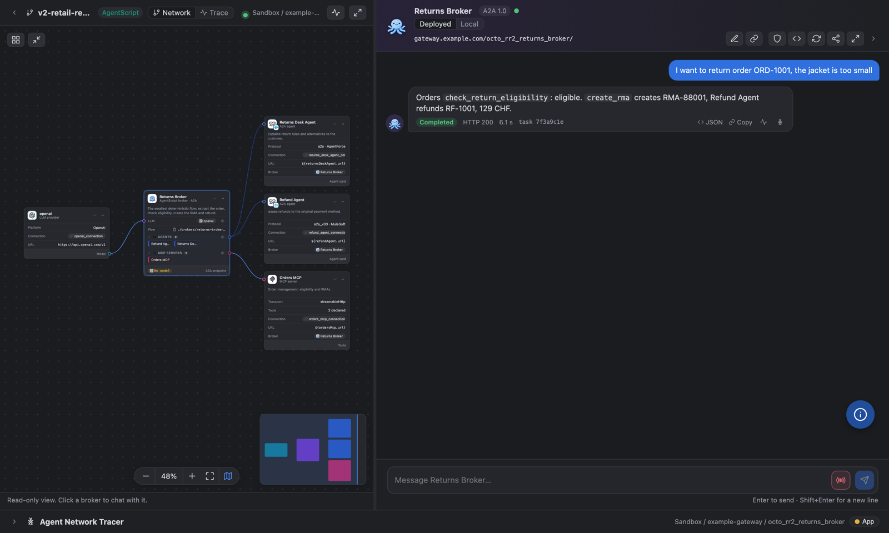

*The reply in the screenshot is an illustration: it shows what the broker answers. The real wording changes from run to run.*

| Prompt | You should see |
|---|---|
| `I want to return order ORD-1001, the jacket is too small` | Orders `check_return_eligibility`: eligible. `create_rma` creates RMA-88001, Refund Agent refunds RF-1001, 129 CHF. |
| `Return ORD-1002 please` | Delivered 47 days ago, outside the 30-day window: declined. Returns Desk offers a 15% voucher (VC-RET-15) or a repair. |
| `Return ORD-9999` | The order is not found, so it is not eligible: the flow takes the decline branch, no RMA. |

The broker is deterministic: the branches are fixed in the flow in `brokers/` (open the `.agent` file to see them). The LLM only reads the ids from your prompt and writes the reply text, so the same input takes the same branch.

### Step 8. Trace a reply

Under each reply, the **Tracer** icon opens the task in the **Agent Network Tracer**: a waterfall of every call the broker made (gateway, broker, LLM, A2A agents, MCP tools) on one time axis, coloured like the cards. Errors are red. Click a span to see its request and response. The **Network** view shows the same reply as a sequence of calls.

### Step 9. Share it (optional)

The **Share** icon in the chat header opens the Share dialog. **A²D sessions** invites people by email to chat with this deployed broker and brings their passed / failed marks and comments back. **Local portal** generates a small web chat you can run or host anywhere.

## Path 3: Build it from scratch

Here you build the same network yourself, starting from a blank project. Every step uses a form, a menu or a button. You never import the template, and you never type YAML or AgentScript. The names below are the template's names without the `octo_rr2_` prefix. You can use your own names, but keep them consistent.

> The text fields take plain values. Where a value looks like `${group.name}`, type it as shown: it is a **variable** that `exchange.json` declares and that deploy fills in.

### Step 3.1. Create a blank project with a starter broker

Connect Octoloom first, as in [Path 2, Step 1](#step-1-connect-octoloom). Then, on **Home**, click **New Deterministic Network**. In **2 Start from**, choose **Blank** and turn on **Add a starter broker**.

- **Broker name**: `Returns Broker`
- **Name**: `retail-returns-scratch` (the Exchange asset id; a different name from the template, so both can live in one org)
- **Parent folder**: pick a folder, then click **Create blank project**.

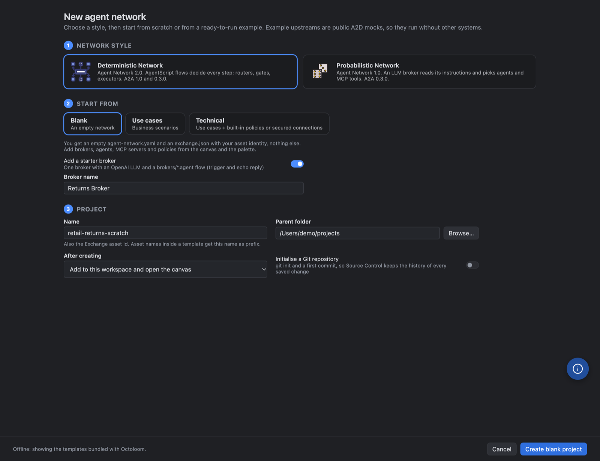

The starter broker `returns_broker` has an OpenAI LLM connection (`openai_connection`, MuleSoft's published OpenAI LLM) and a flow `brokers/returns-broker.agent` with a trigger, one subagent and the built-in `done` reply. The LLM is already done.

### Step 3.2. Add the agents

On the canvas, click **+** (Add to the network) → **Agent** → **Empty**. The new agent opens in the inspector on the right. Fill it in, then repeat for each agent:

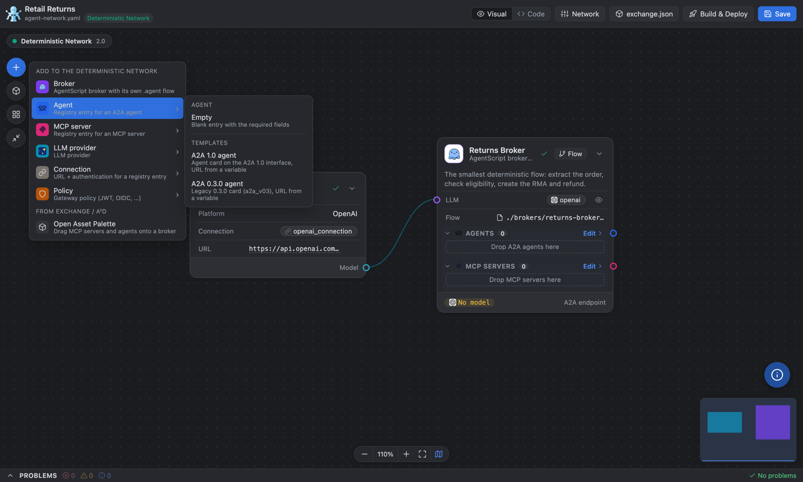

- **Returns Desk Agent**
  - **Identity → Key**: `returns_desk_agent`
  - **Info → Label**: Returns Desk Agent · **Description**: Explains return rules and alternatives to the customer.
  - **Metadata → Platform**: `AgentForce` (or click its icon under **Agent framework**)
  - **Interface**: click `a2a` (A2A 1.0). **Agent card (A2A 1.x)**: **Name** Returns Desk Agent, **Description** as above, **Supported interfaces → URL** `https://www.a2d-ai.com/api/platform/5bf5ade2-6c7a-465b-b465-243935b3ea91/a2a`, Binding `JSONRPC`, Protocol version `1.0`
- **Refund Agent**
  - **Identity → Key**: `refund_agent`
  - **Info → Label**: Refund Agent · **Description**: Issues refunds to the original payment method.
  - **Metadata → Platform**: `MuleSoft` (or click its icon under **Agent framework**)
  - **Interface**: keep `a2a_v03` (A2A 0.3.0). **Agent card (A2A 0.3)**: **Name** Refund Agent, **Description** as above, **URL** `https://www.a2d-ai.com/api/platform/3d1bcf9c-e00f-44dd-8a88-2be871b4d7bb/a2a`

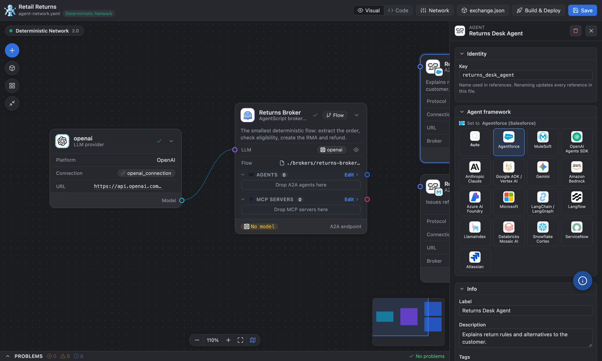

The card skills are optional. Once the agent has a connection (two steps on), the inspector offers **Read skills from the live agent**, which fills them from the running agent.

### Step 3.3. Add the MCP servers

Click **+** → **MCP server** → **Empty**, then fill in:

- **Orders MCP**: **Key** `orders_mcp`, **Label** Orders MCP, **Description** Order management: eligibility and RMAs · **Protocol version** `2025-06-18`. The transport is already Streamable HTTP on `/mcp`.

### Step 3.4. Add the connections

A connection is the URL (and authentication) Agent Fabric uses to reach an agent or an MCP server. Click **+** → **Connection** → **Empty** once per agent and MCP server, and fill in:

| Key | Kind | Registry entry → Name | URL |
|---|---|---|---|
| `returns_desk_agent_connection` | `a2a` | `returns_desk_agent` | `${returnsDeskAgent.url}` |
| `refund_agent_connection` | `a2a` | `refund_agent` | `${refundAgent.url}` |
| `orders_mcp_connection` | `mcp` | `orders_mcp` | `${ordersMcp.url}` |

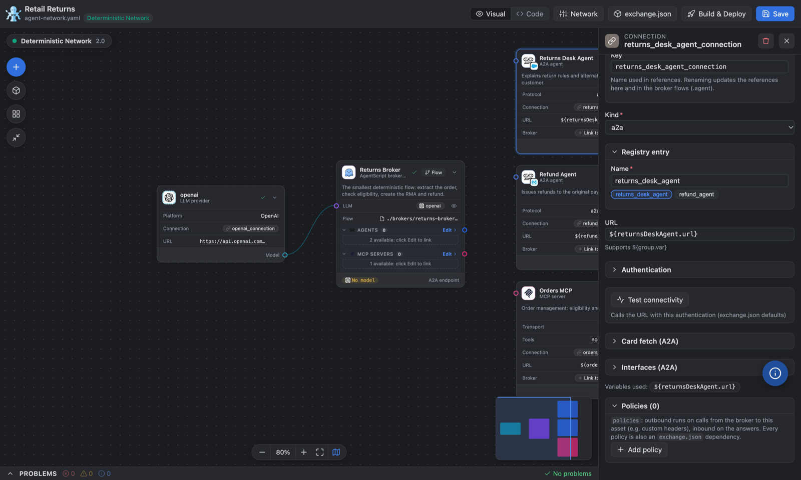

### Step 3.5. Declare the variables

The Problems bar now shows **Variable ${…} is not declared in exchange.json** for each new variable. Click **Add to exchange.json** on each one.

Then open `exchange.json` (it opens as a form) and, under **Variables**, set the defaults:

| Variable | Default |
|---|---|
| `returnsDeskAgent.url` | `https://www.a2d-ai.com/api/platform/5bf5ade2-6c7a-465b-b465-243935b3ea91/a2a` |
| `refundAgent.url` | `https://www.a2d-ai.com/api/platform/3d1bcf9c-e00f-44dd-8a88-2be871b4d7bb/a2a` |
| `ordersMcp.url` | `https://www.a2d-ai.com/api/platform/5aaa63c0-3f1c-462b-bc61-06cb4557ea43/` |

Leave the secret variables (`openai.apiKey`) empty: deploy asks for them and never stores them.

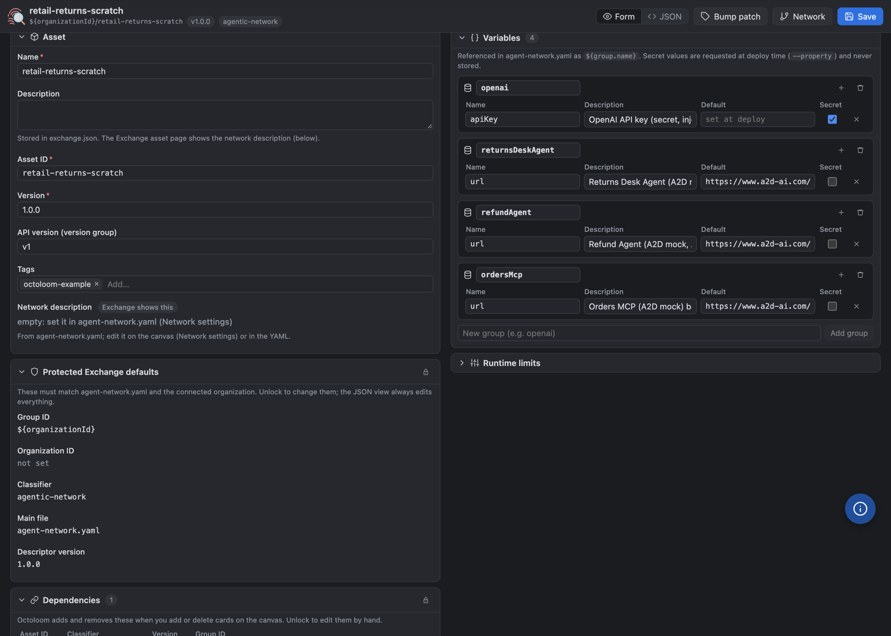

Also click **Remove it** on any **declared but not used** variable that the Problems bar shows.

### Step 3.6. Declare the MCP tools

On each MCP server card, click the **Tools** row (or its pencil). Octoloom reads the tool list from the running server: tick the tools below. You can also type a name in **Add a tool by name…**.

- **Orders MCP**: `check_return_eligibility`, `create_rma`

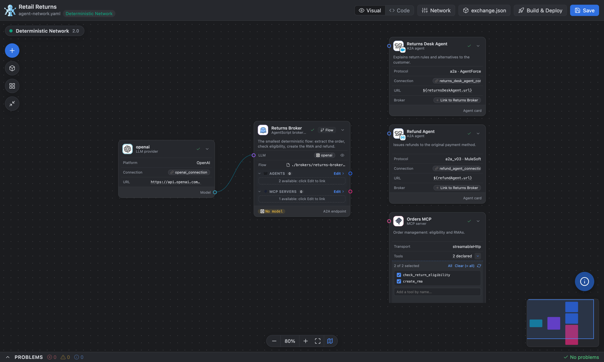

### Step 3.7. Link the agents and MCP servers to the broker

Every agent and MCP card now has a **Broker** row with **Link to Returns Broker**. Click it on each card. Octoloom adds the matching actions to the broker flow: one per agent and one per declared MCP tool.

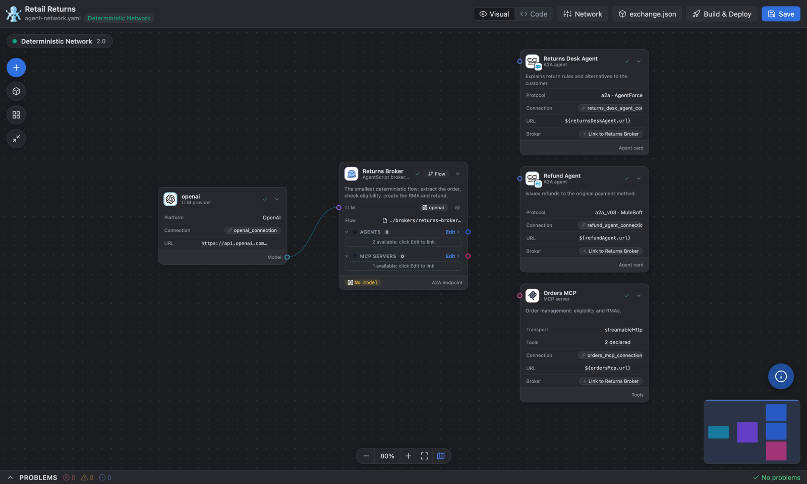

**Link to** also reads the required inputs from the tool schema. In the flow (next step), open **Connections** in the explorer and check that these actions show them under **Inputs** (one per line; type them if they are missing):
- `create_rma`: `order_id: string`, `reason: string`

### Step 3.8. Build the broker flow

On the broker card (or in its inspector), click **Open broker flow**. Then set up the flow:

1. **Settings → Language Settings**: on the `default` model, set **Reasoning effort (OpenAI)** to `MINIMAL`.
2. **Settings → System Messages**: set the instructions to: *You are the returns desk of an online retailer. Process returns only when the order system says the order is eligible.*
3. Select the `assistant` subagent and delete it (trash icon). The trigger and the built-in `done` reply stay.
4. Add the steps below in order. Select the step that comes before, click **Add node**, pick the kind and choose **Empty**, then set its **API name** in **General**. Octoloom wires each new step after the selected one, and you set the exact next step in the inspector.

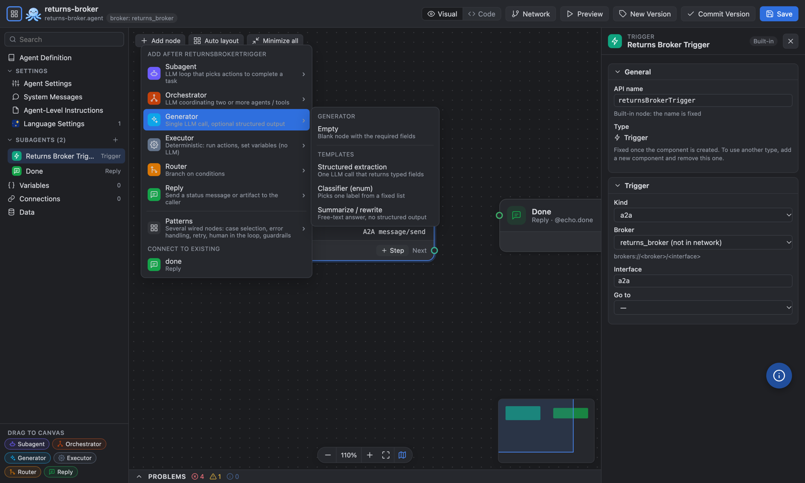

Select the trigger and, under **Go to**, pick `progressExtractReturn` once that step exists.

#### Generator `extractReturn`

- **Label** Extract Return · **Description** Extracts the order id and the return reason from the request.
- **System instructions**:

  > Extract the order id (for example ORD-1001) and a short return reason from the customer message.
  > Use "UNKNOWN" when no order id is present.

- **Prompt**:

  > {!@request.payload.message.parts[0].text}

- **Structured output** (**Add field** for each):
  - `order_id` (string): Order id, e.g. ORD-1001, or UNKNOWN
  - `reason` (string): Short return reason
- **Next step (on exit) → Go to**: `progressEligibilityGate`

#### Subagent `eligibilityGate`

- **Label** Eligibility Gate · **Description** Checks return eligibility with the Orders MCP.
- **System instructions**:

  > Call the eligibility tool for the order id and report whether the order can be returned.
  > Set eligible to "yes" only when the tool returns eligible true.

- **Reasoning instructions**:

  > Order: {!@generator.extractReturn.output.order_id}. Request: {!@request.payload.message.parts[0].text}

- **Actions** (**+ Add action…**): `check_return_eligibility`
- **Limits → Max loops**: `3`
- **Structured output** (**Add field** for each):
  - `eligible` (string): Whether the order can be returned · **Allowed values** `yes`, `no`
  - `detail` (string): Eligibility detail from the tool
- **Next step (on exit) → Go to**: `eligibilityRouter`

#### Router `eligibilityRouter`

- **Description** Eligible orders get an RMA and a refund; the others get advice.
- **Routes** (**+**): **Label** Eligible · **When** `@subagent.eligibilityGate.output.eligible == "yes"` · **Go to** `progressCreateRma`
- **Otherwise → Go to**: `progressExplainDecline`

#### Executor `createRma`

- **Description** Creates the return authorisation.
- **Steps (do)**: **Run action**
  - **Action** `create_rma`
    - **Bind argument** `order_id` = `@generator.extractReturn.output.order_id`
    - **Bind argument** `reason` = `@generator.extractReturn.output.reason`
- **Next step (on exit) → Go to**: `progressRefund`

#### Subagent `refund`

- **Label** Refund · **Description** Issues the refund through the Refund agent.
- **Reasoning instructions**:

  > Refund order {!@generator.extractReturn.output.order_id}. Reason: {!@generator.extractReturn.output.reason}

- **Actions** (**+ Add action…**): `refund_agent`
- **Next step (on exit) → Go to**: `returnAccepted`

#### Reply `returnAccepted`

- **Use expression**, then **Message (expression)**: `"Return accepted for " + @generator.extractReturn.output.order_id + ". " + @subagent.refund.output`
- **Task state**: `TASK_STATE_COMPLETED`

#### Subagent `explainDecline`

- **Label** Explain Decline · **Description** Explains why the return is declined and offers alternatives.
- **Reasoning instructions**:

  > Order {!@generator.extractReturn.output.order_id} cannot be returned: {!@subagent.eligibilityGate.output.detail}. Explain this and offer alternatives.

- **Actions** (**+ Add action…**): `returns_desk_agent`
- **Next step (on exit) → Go to**: `returnDeclined`

#### Reply `returnDeclined`

- **Use expression**, then **Message (expression)**: `@subagent.explainDecline.output`
- **Task state**: `TASK_STATE_COMPLETED`

#### Reply `progressExtractReturn`

- **Message text**: Extracting the order id and the return reason from the request...
- **Task state**: `TASK_STATE_WORKING` (a progress update: the chat shows it while the broker works, then the flow goes on)
- **Next step (on exit) → Go to**: `extractReturn`

#### Reply `progressEligibilityGate`

- **Message text**: Checking return eligibility with the Orders MCP...
- **Task state**: `TASK_STATE_WORKING` (a progress update: the chat shows it while the broker works, then the flow goes on)
- **Next step (on exit) → Go to**: `eligibilityGate`

#### Reply `progressCreateRma`

- **Message text**: Creating the return authorisation...
- **Task state**: `TASK_STATE_WORKING` (a progress update: the chat shows it while the broker works, then the flow goes on)
- **Next step (on exit) → Go to**: `createRma`

#### Reply `progressRefund`

- **Message text**: Issuing the refund through the Refund agent...
- **Task state**: `TASK_STATE_WORKING` (a progress update: the chat shows it while the broker works, then the flow goes on)
- **Next step (on exit) → Go to**: `refund`

#### Reply `progressExplainDecline`

- **Message text**: Explaining why the return is declined and looking for alternatives...
- **Task state**: `TASK_STATE_WORKING` (a progress update: the chat shows it while the broker works, then the flow goes on)
- **Next step (on exit) → Go to**: `explainDecline`

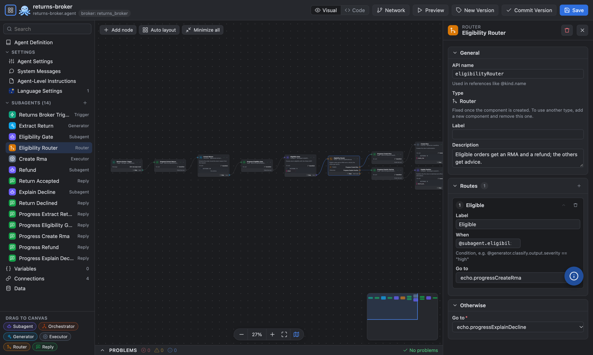

When you are done, the flow matches the template's flow ([Path 2, Step 4](#step-4-follow-the-broker-flow-agentscript)). The built-in `done` reply isn't used by this use case. The Problems bar shows **echo done is not reachable from the trigger** as a warning, and you can leave it.

### Step 3.9. Validate, deploy and chat

Run **Validate** from the canvas CLI menu and fix anything in the Problems bar. Then follow Path 2 from [Validate and build](#step-5-validate-and-build) onwards: deploy (enter the secrets), wait for the green light, open the chat and send the same prompts. Your network answers like the template, because it is the same network, built by hand.

## What you learned

- How a deterministic network is built: an AgentScript flow decides every step; the LLM extracts and writes text.
- How the canvas, the inspector and the code view edit the same YAML.
- How to build the same network from a blank project with forms and menus only (Path 3).
- How to validate, build, deploy, chat and trace with Octoloom.

## Next

- Previous: [Marketing Campaign Studio](../v2-campaign-studio/README.md)
- Next: [Supply Chain Disruption](../v2-supply-chain/README.md)
- Same use case, governed variant: [Retail Returns: governed](../v2-retail-returns-governed/README.md)
- [All tutorials](../README.md)

---
Generated from the `v2-retail-returns` template (Octoloom `media/templates/v2-retail-returns`). Screenshots use fake data.
